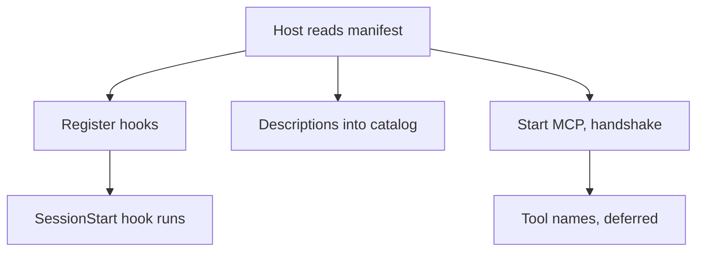
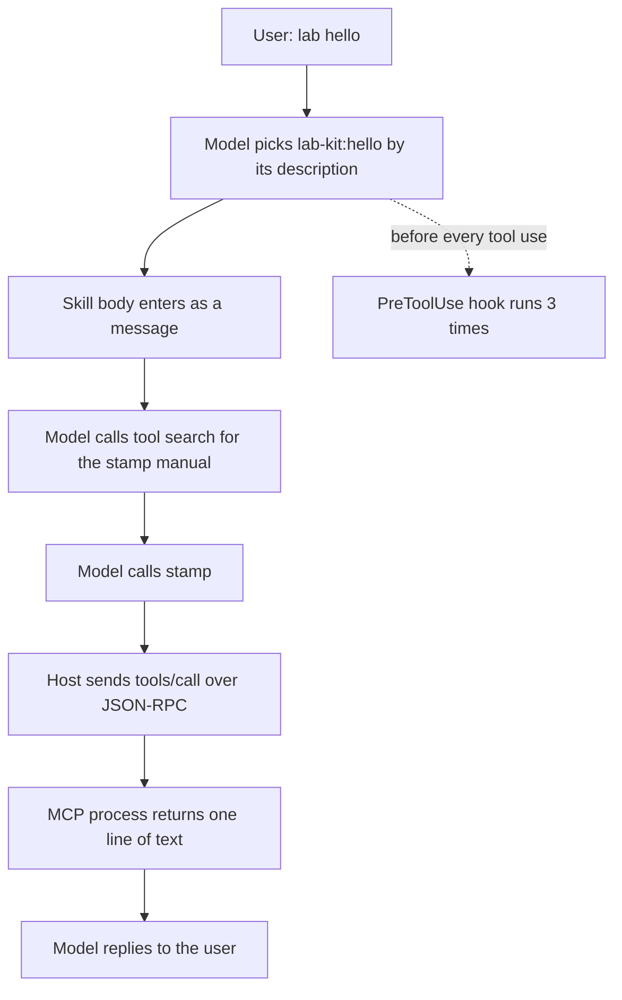

> [!NOTE]
> **Version scope**: Claude Code 2.1.310, tested on Ubuntu 24.04 on 2026-10-30. The MCP messages are verbatim, logged by a minimal server I wrote. **The Codex part comes from documentation only**; Codex is not installed on this machine. If you would rather skip the configs and logs, read the illustrated beginner edition, [What Is an Agent Plugin, Really?](/en/posts/agent-plugins-explained/), first.

```chart
{
  "type": "stats",
  "items": [
    {"label": "A 17 KB skill, standing", "value": "332", "note": "tokens; its ≈6,600-token body loads only when used", "color": "seal"},
    {"label": "One MCP tool, standing", "value": "12", "note": "tokens; its manual is fetched on demand", "color": "gray"},
    {"label": "Two hooks, standing", "value": "0", "note": "run by the host, unseen by the model", "color": "gray"}
  ],
  "caption": "Extra input tokens per conversation versus no plugin. The baseline is an empty conversation of about 42,530 tokens; each case was run twice and differed by at most 5."
}
```

## The short version

1. **A plugin is a unit of distribution, not a unit of runtime.** Once Claude Code loads a plugin, its skills, subagents, hooks and MCP servers each follow their own loading path, exactly as if configured separately. The plugin adds only three things: a manifest, a namespace and a version number.
2. **Only a table of contents stays in context.** Skills and subagents keep a name plus a description there, MCP tools keep a name, and hooks and commands do not enter it at all. Bodies and tool parameter schemas are fetched when used. So **how well the description is written decides whether a part gets used**.
3. **What travels between agents is the parts, not the box.** Skills (the Agent Skills standard) and MCP are already shared across vendors; the box that holds them still has a different folder layout from vendor to vendor. When I gave Claude Code a package in the Agent Plugins 1.0 layout, it installed only the skill.

---

## What you need before reading

You need to know what LLM "tool calling" is: the model emits a structured request, a program outside executes it, and the result goes back into the conversation. You do not need to know Claude Code's configuration or to have read the MCP specification.

A few terms first; the rest of the article uses these names:

| Name | What it is | In Claude Code |
|---|---|---|
| Host | The program that runs the agent loop: assembles context, calls the model, executes tools | Claude Code itself |
| Part | Something a plugin carries; every kind could be used on its own before plugins existed | Skills, subagents, hooks, MCP servers, language servers, commands, monitors |
| Manifest | A small file with the plugin's name, version and description | `.claude-plugin/plugin.json` |
| Marketplace | A catalog that lists some plugins and tells the host where to fetch them | `.claude-plugin/marketplace.json` in a repository |
| Standing cost | The part that is in context on every conversation and every request | Skill and subagent descriptions, tool names |
| On-demand cost | The part that enters context only when a part is used | Skill bodies, tool parameter schemas |

---

## Deriving the plugin from its constraints

Ignore every vendor's implementation and start from four constraints that cannot be avoided. A plugin ends up looking roughly like this:

1. **Context is finite, and every token costs money.** A part cannot keep its full text in context. It can keep a table of contents there and expand on use. This is **progressive disclosure**: name and description → body → the reference files the body points to, one hop per layer.
2. **Some things should not be left to the model.** A rule such as "run the formatter after every edit" might be forgotten or skipped by a model. It has to be executed by the host at a fixed moment; the model does not see it and does not need to. That is a hook.
3. **Tools should run outside the model, ideally outside the host.** Code that queries a database or sends a message has its own language and dependencies. The cleanest boundary is **a separate process plus a message protocol**: that is MCP.
4. **It has to be handed to others, and upgraded.** That needs a name (two people's parts can share a name, hence a namespace), a version number and a catalog of what is available. Those are the manifest and the marketplace.

The smallest causal chain fits in one line: **finite context + the need to share → a standing table of contents, bodies on demand, a versioned package.**

First, separate the details you must keep from the ones you can swap:

- **Keep**: only descriptions stand in context; bodies and tool manuals are fetched on demand; hooks run in the host and stay out of context; MCP tools run in another process; part names carry the plugin's prefix.
- **Swappable**: whether the manifest sits in `.claude-plugin/` or at the root, whether the MCP config is called `.mcp.json` or `mcp.json`, how fields are spelled. These are vendor choices, and the cross-vendor section below shows they really do differ.

---

## Every part in one table

I built a lab plugin, `lab-kit`, with one skill, one subagent, hooks, one MCP server and one command (source below). `claude plugin details` lists the parts and estimates their cost; I then measured by opening an empty conversation with and without the plugin and comparing input tokens:

| Part | Who executes it | Standing in context | Enters context only when used | Standing cost |
| --- | --- | --- | --- | --- |
| Skill `skills/` | The model reads it and follows it | Name + description | The body; files the body points to are read by the model itself | Measured 332 (a 17 KB skill) |
| Subagent `agents/` | The host opens a separate conversation | Name + description | Its system prompt, only inside its own conversation | Estimated ≈40 |
| Hook `hooks/` | The host runs a command on a set event | Nothing | Nothing (unless the hook writes into the conversation) | 0 |
| MCP server `.mcp.json` | A separate process, talking JSON-RPC | Tool names | Tool descriptions and parameter schemas | Measured 12 (one tool) |
| Command `bin/` | Added to PATH, run by the shell | Nothing | Nothing | 0 |
| Language server `.lsp.json` | A separate process | The docs say it pushes diagnostics into context after edits by default | — | Not measured |
| Monitor `monitors/` | The host runs it in the background | — | — | Not measured |

"Measured" is the difference in input tokens between two empty conversations; "estimated" is the figure from `claude plugin details`, which itself notes it "may differ from actual usage." The skill and subagent measured together come to 84 tokens, which matches the estimate of 40 + 40.

```chart
{
  "type": "bars",
  "fmt": {"digits": 0},
  "rows": [
    {"label": "Hooks × 2", "sub": "measured", "value": 0, "color": "gray"},
    {"label": "MCP server, 1 tool", "sub": "measured", "value": 12, "color": "gray"},
    {"label": "Skill + subagent", "sub": "lab plugin, measured", "value": 84, "color": "gray"},
    {"label": "A 17 KB skill", "sub": "audit plugin, measured", "value": 332, "color": "seal"},
    {"label": "The same skill's body", "sub": "when used, estimated", "value": 6600, "color": "blue"}
  ],
  "caption": "In tokens. The first four rows are paid on every conversation; the last is paid once, in the turn where the skill is used."
}
```

The MCP tool adds only 12 tokens because Claude Code **defers MCP tools** by default: only the tool's name sits in context, and when the model wants the tool it first calls a built-in tool search to fetch its manual. The logs in the next section show that step.

---

## One input, end to end

The two diagrams below are what actually happened in this run; solid arrows are paths it really took. First, at start, before anything is typed:



Then I say "lab hello":



Step by step, against the logs.

**Step 1, start.** The host launches the MCP process and first sends a probe, `server/discover`, carrying protocol version 2026-07-28. My minimal server does not know it and answers "method not found," so the host falls back to the older sequence: `initialize` (protocol version 2025-11-25) → `tools/list`. Below is what the server side logged, abridged:

```text
# MCP server-side log (abridged; IN = from the host, OUT = the server's reply)
IN  {"method":"server/discover","params":{"_meta":{"io.modelcontextprotocol/protocolVersion":"2026-07-28", ...}}}
OUT {"error":{"code":-32601,"message":"method not found"}}
IN  {"method":"initialize","params":{"protocolVersion":"2025-11-25","clientInfo":{"name":"claude-code","version":"2.1.310"}, ...}}
OUT {"result":{"protocolVersion":"2025-11-25","capabilities":{"tools":{}},"serverInfo":{"name":"stamp","version":"0.1.0"}}}
IN  {"method":"notifications/initialized"}
IN  {"method":"tools/list","id":1}
OUT {"result":{"tools":[{"name":"stamp","description":"Returns a fixed lab stamp and the server's clock.","inputSchema":{"type":"object","properties":{}}}]}}
```

That shows two things. The host **already holds the tool's full description** at start; it just does not put it in the model's context. And there is a fallback between the new and old protocol versions, so an older server connects without changes.

**Step 2, picking the skill.** I had also installed a second plugin, `lab-other`, which has a skill called `hello` too. Both are in the host's startup report, named `lab-kit:hello` and `lab-other:hello`. The model picked the first by its description ("Use when the user says 'lab hello'"), through the built-in skill tool:

```json open
{"type": "tool_use", "name": "Skill", "input": {"skill": "lab-kit:hello"}}
```

**Step 3, the body comes in.** The tool result is a single line, "Launching skill: lab-kit:hello". The body arrives as **the user-role message right after it**, prefixed with the skill's folder (so relative paths in the body resolve). In other words, a skill does not change the system prompt; it is inserted into the conversation at the moment it is needed and stays in that conversation's history afterwards.

**Step 4, fetching the tool manual.** The body tells the model to call `stamp`. The model first calls tool search:

```json open
{"type": "tool_use", "name": "ToolSearch", "input": {"query": "select:mcp__plugin_lab-kit_stamp__stamp", "max_results": 1}}
```

Note the tool's full name, `mcp__plugin_lab-kit_stamp__stamp`: "MCP," "from plugin lab-kit," "server stamp," "tool stamp." This is how the namespace is carried all the way down.

**Step 5, the call.** The host translates the call into JSON-RPC for the MCP process; `_meta` carries the call's id in the conversation so both sides can match them up:

```text
IN  {"method":"tools/call","params":{"name":"stamp","arguments":{},"_meta":{"claudecode/toolUseId":"toolu_019t...","progressToken":2}},"id":2}
OUT {"result":{"content":[{"type":"text","text":"stamp ok @ 14:07:26"}]}}
```

**Step 6, the hooks are there throughout.** The lab plugin registers two hooks: one at start, one before every tool use. In this run `PreToolUse` fired 3 times, before the skill call, the tool search and the `stamp` call. A hook receives a JSON object on standard input with these fields:

```text
SessionStart  cwd, hook_event_name, scratchpad_dir, session_id, source, transcript_path
PreToolUse    cwd, effort, hook_event_name, permission_mode, prompt_id, scratchpad_dir,
              session_id, tool_input, tool_name, tool_use_id, transcript_path
              (plus mcp_server when an MCP tool is called)
```

A hook sees the tool name and the full arguments and can block the call; its output does not enter the model's context by default, which is why its standing cost measured 0.

> [!WARNING]
> **None of those 3 hook runs asked me.** Once a plugin is enabled, its hooks run arbitrary commands under your permissions on their own; the MCP process starts when work starts; commands in `bin/` go straight onto PATH (I asked the model to run `lab-hello` and it simply worked). To review a plugin, read `hooks/hooks.json`, `.mcp.json` and `bin/` first, then what the skills say.

---

## The lab plugin's source

The whole plugin is eight files. The manifest needs only a name; version and description are for people and marketplaces:

```text open
lab-kit/
├── .claude-plugin/plugin.json
├── skills/hello/SKILL.md
├── agents/reviewer.md
├── hooks/hooks.json
├── hooks/log.sh
├── .mcp.json
├── servers/stamp.py
└── bin/lab-hello
```

```jsonc
// .claude-plugin/plugin.json: the manifest
{
  "name": "lab-kit",
  "version": "0.1.0",
  "description": "A lab plugin with one of each component, to see what loads when."
}
```

The skill's description tells the model both "what this is" and "when to use it." That one line is its entire standing cost:

```markdown
<!-- skills/hello/SKILL.md: the skill -->
---
name: hello
description: Greets the user in the lab-kit house style. Use when the user says "lab hello".
---

# Lab hello

When this skill runs, reply with exactly one line:

`lab-kit hello: skill body loaded (marker 7f3a)`

Then call the `stamp` tool from the lab-kit MCP server once and repeat what it returns.
```

```jsonc
// hooks/hooks.json: at start and before every tool use, log the JSON received
{
  "hooks": {
    "SessionStart": [
      { "hooks": [ { "type": "command", "command": "\"${CLAUDE_PLUGIN_ROOT}\"/hooks/log.sh SessionStart" } ] }
    ],
    "PreToolUse": [
      { "matcher": ".*", "hooks": [ { "type": "command", "command": "\"${CLAUDE_PLUGIN_ROOT}\"/hooks/log.sh PreToolUse" } ] }
    ]
  }
}
```

The host replaces `${CLAUDE_PLUGIN_ROOT}` with where the plugin is installed on this machine. The host decides where plugins go, so configs must use it instead of a fixed path.

```jsonc
// .mcp.json: the MCP server the plugin brings
{
  "mcpServers": {
    "stamp": {
      "command": "python3",
      "args": ["${CLAUDE_PLUGIN_ROOT}/servers/stamp.py"]
    }
  }
}
```

The MCP server needs no library: one JSON-RPC message per line, four methods handled, and a host can connect to it.

```python
# servers/stamp.py: a minimal MCP server (complete except for logging)
import json, sys, time

TOOL = {"name": "stamp", "description": "Returns a fixed lab stamp and the server's clock.",
        "inputSchema": {"type": "object", "properties": {}}}

def send(msg):
    sys.stdout.write(json.dumps(msg) + "\n"); sys.stdout.flush()

for line in sys.stdin:
    msg = json.loads(line)
    method, mid = msg.get("method"), msg.get("id")
    if mid is None:
        continue  # a notification, such as notifications/initialized: no reply
    if method == "initialize":
        send({"jsonrpc": "2.0", "id": mid, "result": {
            "protocolVersion": msg["params"]["protocolVersion"],
            "capabilities": {"tools": {}}, "serverInfo": {"name": "stamp", "version": "0.1.0"}}})
    elif method == "tools/list":
        send({"jsonrpc": "2.0", "id": mid, "result": {"tools": [TOOL]}})
    elif method == "tools/call":
        send({"jsonrpc": "2.0", "id": mid, "result": {"content": [
            {"type": "text", "text": "stamp ok @ " + time.strftime("%H:%M:%S")}]}})
    else:
        send({"jsonrpc": "2.0", "id": mid, "error": {"code": -32601, "message": "method not found"}})
```

Nothing in this code is specific to Claude Code; any host that speaks MCP can connect to it. The box is Claude Code's; the parts inside are not.

---

## Namespaces, versions and marketplaces

**Same names do not collide.** Both plugins ship a `hello` skill; the host prefixes each with its plugin name, `lab-kit:hello` and `lab-other:hello`, and a user calling one by hand also uses the prefix (`/lab-kit:hello`). Subagents work the same way (`lab-kit:reviewer`), and MCP tools carry a longer prefix, as shown above. With the prefixes in place, choosing between them is left to the model reading descriptions, so **the more alike two plugins' descriptions are, the easier it is to pick the wrong one**.

**A marketplace is just a catalog.** My public audit plugin keeps the marketplace and the plugin in one repository, and `marketplace.json` lists only itself:

```jsonc
// .claude-plugin/marketplace.json: a marketplace that lists only itself
{
  "name": "llm-relay-audit",
  "owner": { "name": "YouToco", "url": "https://github.com/YouToco" },
  "plugins": [
    { "name": "llm-relay-audit", "source": "./", "description": "Audit third-party AI API relays / resellers against the official API (text + video), with an evidence report generator." }
  ]
}
```

A user adds the marketplace and installs the plugin in two commands: `/plugin marketplace add YouToco/llm-relay-audit`, then `/plugin install llm-relay-audit@llm-relay-audit`. No review, no server; upgrades follow the version number in the manifest.

**Validation has two levels.** `claude plugin validate` passed the lab plugin, but separately listed two things the **official plugin directory would refuse**: no README and no license; it also warned there was no icon. In other words, "installs" and "can be listed in the official directory" are two different bars.

When I turned two skills from my job into plugins and published them to my team's plugin library, I hit two pitfalls the validator does not mention:

- **Symbolic links are not uploaded.** Locally the skill folder was a symlink into the plugin folder so both places shared it; publishing takes only real files inside the plugin folder.
- **Once a name is taken, the only way out is a new name.** With an old entry of the same name already in the library, the new plugin would not publish; renaming the plugin (the skill kept its name) is what fixed it.

---

## Across vendors: what travels

The three things are standardized to different degrees:

| | Skills | MCP servers | The plugin box |
|---|---|---|---|
| Shared standard? | Yes: Agent Skills (opened 2025-12, agentskills.io) | Yes: MCP (under the Linux Foundation since 2025-12) | One: Agent Plugins 1.0 (2026-08), not yet widespread |
| Who reads it | Claude Code, Codex, Gemini CLI, Cursor, Copilot and others | Every mainstream agent | Most vendors use their own layout |
| My test on Claude Code | The skill in the neutral layout installed | `mcp.json` in the neutral layout did not | The root manifest was not read; the folder name was used |

Agent Plugins 1.0 is maintained by a committee from Amazon, Cursor, Microsoft, OpenAI and Vercel; Google joined in 2026-08. It is deliberately small: one `plugin.json` at the root, skills in `skills/`, MCP servers in `mcp.json` with the transport stated on every entry. Things that differ by vendor, such as hooks, subagents and commands, go in an extension folder named by reverse domain (for example `com.example.client/`), which hosts that do not recognize it skip. It **defines the format only**: not installation, permissions, sandboxing or trust.

It differs from Claude Code's own layout in three places: where the manifest lives (root vs `.claude-plugin/`), what the MCP config is called (`mcp.json` vs `.mcp.json`), and where hooks and subagents go (an extension folder vs the top level). I built a package in the neutral layout and gave it to Claude Code 2.1.310:

- `skills/hello` installed, as `open-format:hello`. The skills folder sits in the same place in both layouts, which is why it worked.
- The server in `mcp.json` was not started.
- I changed the name in the root `plugin.json` to `agent-plugins-sample`, and the plugin was still named after its folder, `open-format`: the root manifest was not read.

According to third-party reporting, the plugin marketplace Codex opened in 2026-03 copies Claude Code's folder layout almost exactly, and OpenAI even ships, in Claude Code's format, a plugin that lets Claude Code call Codex. **I did not test this on Codex**; I read the reporting and OpenAI's help documentation, which says a Codex plugin can contain skills, MCP servers and hooks.

So for anything meant for several agents, think about portability in this order: **skills travel most easily, MCP servers next, and the box currently has to be packed once per host**, or you wait for Agent Plugins to be read by more hosts.

---

## Why the first generation died and this one is different

The ChatGPT plugins of 2023 and today's plugins share a name and do almost everything the opposite way:

| | ChatGPT plugins (2023-03 → 2024-04) | Agent plugins (since 2025-10) |
|---|---|---|
| What is inside | A web API: an OpenAPI description + a manifest at a fixed path | A folder: mostly manuals, with tools included |
| Where code runs | The developer's own server | The user's machine (hooks, MCP processes, commands) |
| How the model knows how to use it | It reads natural-language fields in the API description and decides when to call | The skill body says directly "this job has these steps, use this for each" |
| Distribution | Platform review and listing | A git repository + a catalog file |
| Cross-platform? | No | Skills and MCP yes; the box not entirely |

In my view the third row decided the outcome. The first generation left the model to read an API description and guess when and how to call. The APIs were fine; **what was missing was knowledge of how to do the work**. In this generation the most valuable thing in a plugin is the manual. It takes processes that used to live in a wiki, in group chats and in senior colleagues' heads, and turns them into text an agent reads on demand. The tools are just means the manual mentions.

The cost comes from the same row: code moved from the developer's server onto the user's machine, and review moved from the platform back to the user.

---

## When to build a plugin

| What you have | What to ship |
|---|---|
| A way of doing a job, maybe with a few scripts | A skill is enough; put it in the repository or publish it per the Agent Skills standard |
| An external service you want many agents to use | An MCP server |
| A skill + the tools it depends on + a few team rules (hooks), to install and upgrade as one set | A plugin |
| The same set for different agents | Write the parts to the shared standards and pack the box once per host |

Google's post introducing Agent Plugins makes the same call: with a single skill, or a single MCP server for a single host, you do not need a plugin; the box earns its keep **when several parts have to travel together**.

---

## What was measured and what is inference

- **Measured** (2026-10-30, Claude Code 2.1.310): the four standing costs; the skill body entering as a user message; MCP tools fetched through tool search; the `server/discover` probe and fallback; how often the hooks fired and their fields; `bin/` on PATH; prefixes on same-named skills; only the skill installing from the neutral layout; the two levels of `validate`.
- **Tool estimates**: about 40 tokens for the subagent and about 6,600 for the skill body, from `claude plugin details`.
- **Documentation only**: how language servers and monitors behave; the Codex plugin format; what Agent Plugins 1.0 specifies.
- **Inference**: that the first generation failed mainly for lack of process knowledge. That is my judgment; third-party retrospectives also commonly cite "one platform only" and "the review gate."
- **May change**: whether MCP tools are deferred and how a skill body is inserted are host implementation choices and may change between versions; the idea of keeping only descriptions standing is unlikely to.

---

## Takeaways

1. A plugin does not change how its parts behave; it solves **distribution**: namespaces, versions, one install for a whole set.
2. Standing cost ≈ the total length of all descriptions. **The description is a part's only way in**: say what it is and when to use it.
3. Hooks, MCP processes and commands run with your permissions where the model cannot see. Review those three first.
4. To reach several agents, put the effort into skills and MCP servers; keep the box thin and pack it once per host.

**In one line: the valuable thing in a plugin is not the box; it is the few pages of manual inside.**

---

<details>
<summary>Appendix: commands to reproduce, full measurements, sources</summary>

**Reproduce** (the lab plugin's complete source is above; put it in any folder):

```bash
# Validate the plugin (two levels: installs / can be listed in the official directory)
claude plugin validate ./lab-kit

# List the parts and estimated token cost (--plugin-dir loads it for this run only)
claude --plugin-dir ./lab-kit plugin details lab-kit

# Measure standing cost: turn off other MCP servers, compare an empty conversation's input tokens
claude -p "Reply with just: ok" --output-format stream-json --verbose \
  --strict-mcp-config --no-chrome --plugin-dir ./lab-kit
#   input tokens = input_tokens + cache_creation_input_tokens + cache_read_input_tokens

# Trace one input: allow skills, tool search and the plugin's MCP tool, then read every stream-json step
LAB_LOG_DIR=./logs claude -p "lab hello" --output-format stream-json --verbose \
  --plugin-dir ./lab-kit --plugin-dir ./lab-other \
  --allowedTools "Skill,ToolSearch,mcp__plugin_lab-kit_stamp__stamp"
```

Note that `--strict-mcp-config` also turns off the plugin's own MCP server, so for the MCP row I connected the same server separately with `--mcp-config`.

**Full measurements** (input tokens, each case run twice):

| Case | Run 1 | Run 2 | Over baseline |
|---|---|---|---|
| Baseline: no plugin | 42,530 | 42,535 | — |
| Lab plugin (skill + subagent + hooks) | 42,616 | 42,618 | 84 |
| Audit plugin (one 17 KB skill) | 42,864 | 42,864 | 332 |
| One MCP server, 1 tool | 42,543 | 42,545 | 12 |

Without `--strict-mcp-config` the numbers were unstable: the run with two plugins installed came in about 1,100 tokens *below* the run with none, because the remote MCP servers on my account sometimes connected before the first request and sometimes did not. So every row above was measured with them turned off.

**Sources** (checked 2026-10-30):

- Claude Code plugins reference: <https://code.claude.com/docs/en/plugins-reference>
- The Agent Skills standard: <https://agentskills.io>
- The MCP specification: <https://modelcontextprotocol.io>
- Agent Plugins 1.0 (Google Developers Blog, 2026-08-06): <https://developers.googleblog.com/agent-plugins-package-your-skills-tools-and-more/>
- Cowork plugins (Anthropic, 2026-01-30): <https://claude.com/resources/articles/cowork-plugins>
- The Codex plugin marketplace and format (third-party reporting, 2026-09-08): <https://sourcefeed.dev/a/codex-plugins-settle-the-agent-extension-format-war>
- OpenAI help docs, "Skills & Plugins": <https://learn.chatgpt.com/docs/skills-and-plugins>
- A protocol history of tool use (dates for ChatGPT plugins, function calling and MCP): <https://absolutedigitalpublishers.com/articles/how-ai-models-learned-to-use-tools-a-protocol-history>
- The audit plugin used as a sample here: <https://github.com/YouToco/llm-relay-audit>

</details>
