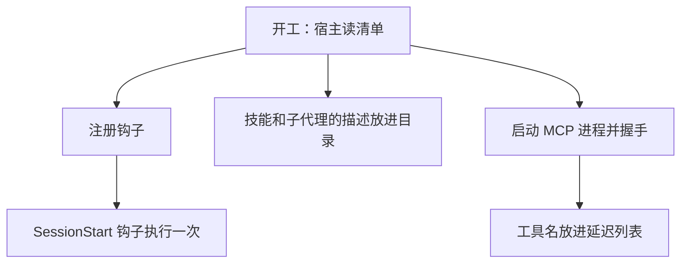
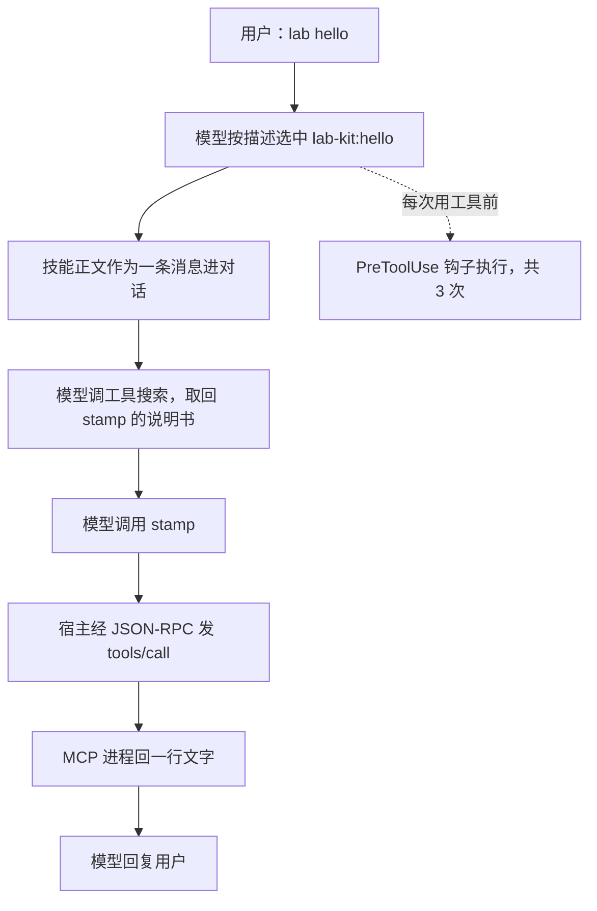

> [!NOTE]
> **版本范围**：Claude Code 2.1.310，2026-10-30 在 Ubuntu 24.04 上实测；MCP 消息是我自己写的最小服务器记下来的原文。**Codex 那部分只读了文档**，这台机器上没装 Codex。不想看配置和日志的话，先读入门图解版[《插件到底是什么》](/posts/agent-plugins-explained/)。

```chart
{
  "type": "stats",
  "items": [
    {"label": "17 KB 的技能，常驻", "value": "332", "note": "token；正文约 6,600 token，用到才读", "color": "seal"},
    {"label": "一个 MCP 工具，常驻", "value": "12", "note": "token；说明书按需取", "color": "gray"},
    {"label": "两个钩子，常驻", "value": "0", "note": "宿主执行，模型看不见", "color": "gray"}
  ],
  "caption": "每次对话比不装插件多出的输入 token。基线是一次空对话，约 42,530 token；每种情况跑两遍，差别不超过 5。"
}
```

## 先说结论

1. **插件是分发单位，不是运行时单位。** Claude Code 加载插件后，里面的技能、子代理、钩子、MCP 服务器各走各的加载路径，和单独配置时一样。插件额外带来的只有三样：一个清单、一个命名空间、一个版本号。
2. **上下文里常驻的只有「目录」。** 技能和子代理常驻名字 + 描述，MCP 工具常驻名字，钩子和命令不进上下文。正文、工具的参数说明都是用到时才取。所以**描述写得好不好，决定零件能不能被用上**。
3. **能跨 agent 带走的是零件，不是盒子。** 技能（Agent Skills 标准）和 MCP 已经是多家通用的；装它们的盒子，各家目录布局仍然不同。我把一个按 Agent Plugins 1.0 布局打的包交给 Claude Code，它只装上了技能。

---

## 读之前你需要知道

你需要知道大模型的「工具调用」是什么：模型输出一段结构化请求，由外面的程序去执行，再把结果送回对话。不需要会 Claude Code 的配置，也不需要读过 MCP 规范。

几个词先对齐，后文都用这里的叫法：

| 叫法 | 是什么 | 在 Claude Code 里 |
|---|---|---|
| 宿主 | 跑 agent 循环的程序：组装上下文、调模型、执行工具 | Claude Code 本身 |
| 零件 | 插件里装的东西，每种在插件出现前都能单独用 | 技能、子代理、钩子、MCP 服务器、语言服务器、命令、监视器 |
| 清单 | 写着插件名字、版本、描述的小文件 | `.claude-plugin/plugin.json` |
| 市场 | 一份列出若干插件、告诉宿主去哪取的目录 | 仓库里的 `.claude-plugin/marketplace.json` |
| 常驻成本 | 每次对话、每次请求都在上下文里的那部分 | 技能和子代理的描述、工具名 |
| 按需成本 | 用到某个零件时才进上下文的那部分 | 技能正文、工具的参数说明 |

---

## 从约束推出插件的样子

不看任何一家的实现，只从四个绕不开的约束出发，插件大概就该长这样：

1. **上下文是有限的，每个 token 都要钱。** 零件不能把全文常驻在上下文里，只能常驻一张目录，用到再展开。这就是**渐进披露**：名字和描述 → 正文 → 正文里引用的参考资料，一层一跳。
2. **有些事不该交给模型决定。** 「每次改完文件都跑格式化」这类规则，模型可能忘、可能跳过。它们得由宿主在固定时刻执行，模型看不见，也不用看见。这就是钩子。
3. **工具要在模型外面跑，最好在宿主外面跑。** 查数据库、发消息的代码各有各的语言和依赖，最干净的边界是**一个独立进程 + 一套消息协议**，这就是 MCP。
4. **要能递给别人，还要能升级。** 这就需要一个名字（两个人的零件可能重名，所以要命名空间）、一个版本号、一个能列出「有哪些可装」的目录。这就是清单和市场。

最小的因果链只有一句：**上下文有限 + 要分享 → 目录常驻、正文按需、打包带版本。**

哪些细节必须记住、哪些可以换掉，先分清：

- **必须记住**：常驻的只有描述；正文和工具说明是按需取的；钩子由宿主执行、不进上下文；MCP 工具跑在另一个进程里；零件名带插件前缀。
- **可以替换**：清单放在 `.claude-plugin/` 还是根目录、MCP 配置叫 `.mcp.json` 还是 `mcp.json`、字段名怎么拼。这些是各家的选择，下面跨厂商那节会看到它们确实不一样。

---

## 零件总表

我搭了一个实验插件 `lab-kit`，技能、子代理、钩子、MCP 服务器、命令每样放一个（源码在后面）。`claude plugin details` 会列出零件并估算成本，我再用「装 / 不装各开一次空对话、比较输入 token」实测：

| 零件 | 谁执行 | 常驻上下文里的是 | 用到时才进来的是 | 常驻成本 |
| --- | --- | --- | --- | --- |
| 技能 `skills/` | 模型读、照做 | 名字 + 描述 | 正文；正文引用的文件由模型自己去读 | 实测 332（17 KB 的技能） |
| 子代理 `agents/` | 宿主另开一段对话 | 名字 + 描述 | 它的系统提示，只进它自己的那段对话 | 估算约 40 |
| 钩子 `hooks/` | 宿主在固定事件执行命令 | 无 | 无（除非钩子主动往对话里写东西） | 0 |
| MCP 服务器 `.mcp.json` | 独立进程，JSON-RPC 通信 | 工具名 | 工具的描述和参数结构 | 实测 12（一个工具） |
| 命令 `bin/` | 加进 PATH，由 shell 执行 | 无 | 无 | 0 |
| 语言服务器 `.lsp.json` | 独立进程 | 文档说默认会把改完代码后的报错推进上下文 | — | 没测 |
| 监视器 `monitors/` | 宿主在后台跑 | — | — | 没测 |

「实测」是两次空对话的输入 token 之差；「估算」是 `claude plugin details` 给的数，它自己注明「可能和实际用量不同」。技能和子代理放在一起实测是 84 token，和估算的 40 + 40 对得上。

```chart
{
  "type": "bars",
  "fmt": {"digits": 0},
  "rows": [
    {"label": "钩子 × 2", "sub": "实测", "value": 0, "color": "gray"},
    {"label": "MCP 服务器，1 个工具", "sub": "实测", "value": 12, "color": "gray"},
    {"label": "技能 + 子代理", "sub": "实验插件，实测", "value": 84, "color": "gray"},
    {"label": "17 KB 的技能", "sub": "检测插件，实测", "value": 332, "color": "seal"},
    {"label": "同一个技能的正文", "sub": "用到时，估算", "value": 6600, "color": "blue"}
  ],
  "caption": "单位：token。前四行是每次对话都要付的；最后一行只在这个技能被用上的那一轮付一次。"
}
```

MCP 工具只多了 12 token，是因为 Claude Code 默认**把 MCP 工具延迟加载**：上下文里只放一个工具名，模型要用时先调一个内置的「工具搜索」把说明书取回来。下一节的日志里能看到这一步。

---

## 一条输入走到底

下面两张图是这次运行里实际发生的事，实线是确实走过的路径。先是开工时，还没输入任何东西：



然后我说「lab hello」：



逐步对着日志看。

**第 1 步，开工。** 宿主启动 MCP 进程，先发了一个探测请求 `server/discover`，带的协议版本是 2026-07-28。我那个最小服务器不认识它，回了「方法不存在」，宿主就退回老办法：`initialize`（协议版本 2025-11-25）→ `tools/list`。下面是服务器这一侧记下的原文，节选：

```text
# MCP 服务器一侧的日志（节选，IN = 宿主发来，OUT = 服务器回）
IN  {"method":"server/discover","params":{"_meta":{"io.modelcontextprotocol/protocolVersion":"2026-07-28", ...}}}
OUT {"error":{"code":-32601,"message":"method not found"}}
IN  {"method":"initialize","params":{"protocolVersion":"2025-11-25","clientInfo":{"name":"claude-code","version":"2.1.310"}, ...}}
OUT {"result":{"protocolVersion":"2025-11-25","capabilities":{"tools":{}},"serverInfo":{"name":"stamp","version":"0.1.0"}}}
IN  {"method":"notifications/initialized"}
IN  {"method":"tools/list","id":1}
OUT {"result":{"tools":[{"name":"stamp","description":"Returns a fixed lab stamp and the server's clock.","inputSchema":{"type":"object","properties":{}}}]}}
```

这说明两件事：宿主在开工时就**拿到了工具的完整说明**，只是没把它放进模型的上下文；新旧协议版本之间有一个回退过程，老服务器不用改也能接。

**第 2 步，选技能。** 我同时装了另一个插件 `lab-other`，里面也有一个叫 `hello` 的技能。宿主的启动信息里两个都在，名字分别是 `lab-kit:hello` 和 `lab-other:hello`。模型按描述（「用户说 lab hello 时用」）选中了前者，调用的是内置的「技能」工具：

```json open
{"type": "tool_use", "name": "Skill", "input": {"skill": "lab-kit:hello"}}
```

**第 3 步，正文进来。** 工具结果只有一句「Launching skill: lab-kit:hello」。正文是**紧跟着的一条用户角色消息**，开头还带着技能所在的目录（这样正文里写的相对路径能找到）。也就是说，技能没有改系统提示，它是在需要的那一刻作为对话的一部分插进来的，之后一直留在这段对话的历史里。

**第 4 步，取工具说明书。** 正文让模型调用 `stamp`。模型先调了工具搜索：

```json open
{"type": "tool_use", "name": "ToolSearch", "input": {"query": "select:mcp__plugin_lab-kit_stamp__stamp", "max_results": 1}}
```

注意工具的全名：`mcp__plugin_lab-kit_stamp__stamp`，依次是「MCP」「来自插件 lab-kit」「服务器 stamp」「工具 stamp」。命名空间就是这样一路带下来的。

**第 5 步，调用。** 宿主把调用翻译成 JSON-RPC 发给 MCP 进程，`_meta` 里带着这次调用在对话里的 id，方便两边对账：

```text
IN  {"method":"tools/call","params":{"name":"stamp","arguments":{},"_meta":{"claudecode/toolUseId":"toolu_019t...","progressToken":2}},"id":2}
OUT {"result":{"content":[{"type":"text","text":"stamp ok @ 14:07:26"}]}}
```

**第 6 步，钩子一直在旁边。** 实验插件注册了两个钩子：开工时一次，每次用工具前一次。这一轮里 `PreToolUse` 响了 3 次，分别在调技能、调工具搜索、调 `stamp` 之前。钩子从标准输入收到一段 JSON，字段是这些：

```text
SessionStart  cwd, hook_event_name, scratchpad_dir, session_id, source, transcript_path
PreToolUse    cwd, effort, hook_event_name, permission_mode, prompt_id, scratchpad_dir,
              session_id, tool_input, tool_name, tool_use_id, transcript_path
              （调 MCP 工具时多一个 mcp_server）
```

钩子能看到工具名和完整参数，可以拦下这次调用；但它的输出默认不进模型的上下文，所以前面实测常驻成本是 0。

> [!WARNING]
> 这 3 次钩子**都没有问我**。插件启用后，它的钩子就在你的权限下自动执行任意命令；MCP 进程开工即启动；`bin/` 里的命令直接进了 PATH（我让模型跑 `lab-hello`，它直接跑通了）。审一个插件，先看 `hooks/hooks.json`、`.mcp.json` 和 `bin/`，再看技能写了什么。

---

## 实验插件的源码

整个插件八个文件。清单只需要名字，版本和描述是给人和市场看的：

```text open
lab-kit/
├── .claude-plugin/plugin.json
├── skills/hello/SKILL.md
├── agents/reviewer.md
├── hooks/hooks.json
├── hooks/log.sh
├── .mcp.json
├── servers/stamp.py
└── bin/lab-hello
```

```jsonc
// .claude-plugin/plugin.json：清单
{
  "name": "lab-kit",
  "version": "0.1.0",
  "description": "A lab plugin with one of each component, to see what loads when."
}
```

技能的描述同时告诉模型「这是什么」和「什么时候用」，这一行就是它全部的常驻成本：

```markdown
<!-- skills/hello/SKILL.md：技能 -->
---
name: hello
description: Greets the user in the lab-kit house style. Use when the user says "lab hello".
---

# Lab hello

When this skill runs, reply with exactly one line:

`lab-kit hello: skill body loaded (marker 7f3a)`

Then call the `stamp` tool from the lab-kit MCP server once and repeat what it returns.
```

```jsonc
// hooks/hooks.json：开工时和每次用工具前，都把收到的 JSON 记一行
{
  "hooks": {
    "SessionStart": [
      { "hooks": [ { "type": "command", "command": "\"${CLAUDE_PLUGIN_ROOT}\"/hooks/log.sh SessionStart" } ] }
    ],
    "PreToolUse": [
      { "matcher": ".*", "hooks": [ { "type": "command", "command": "\"${CLAUDE_PLUGIN_ROOT}\"/hooks/log.sh PreToolUse" } ] }
    ]
  }
}
```

`${CLAUDE_PLUGIN_ROOT}` 由宿主换成插件装在本机的位置。插件装到哪是宿主决定的，所以配置里只能这样写，不能写死路径。

```jsonc
// .mcp.json：插件带的 MCP 服务器
{
  "mcpServers": {
    "stamp": {
      "command": "python3",
      "args": ["${CLAUDE_PLUGIN_ROOT}/servers/stamp.py"]
    }
  }
}
```

MCP 服务器不需要任何库：一行一条 JSON-RPC 消息，处理四种方法就能被宿主接上。

```python
# servers/stamp.py：最小的 MCP 服务器（完整，日志部分略）
import json, sys, time

TOOL = {"name": "stamp", "description": "Returns a fixed lab stamp and the server's clock.",
        "inputSchema": {"type": "object", "properties": {}}}

def send(msg):
    sys.stdout.write(json.dumps(msg) + "\n"); sys.stdout.flush()

for line in sys.stdin:
    msg = json.loads(line)
    method, mid = msg.get("method"), msg.get("id")
    if mid is None:
        continue  # 通知，比如 notifications/initialized，不用回
    if method == "initialize":
        send({"jsonrpc": "2.0", "id": mid, "result": {
            "protocolVersion": msg["params"]["protocolVersion"],
            "capabilities": {"tools": {}}, "serverInfo": {"name": "stamp", "version": "0.1.0"}}})
    elif method == "tools/list":
        send({"jsonrpc": "2.0", "id": mid, "result": {"tools": [TOOL]}})
    elif method == "tools/call":
        send({"jsonrpc": "2.0", "id": mid, "result": {"content": [
            {"type": "text", "text": "stamp ok @ " + time.strftime("%H:%M:%S")}]}})
    else:
        send({"jsonrpc": "2.0", "id": mid, "error": {"code": -32601, "message": "method not found"}})
```

这段代码里没有任何 Claude Code 专有的东西，换一个支持 MCP 的宿主照样能接。插件这层盒子是 Claude Code 的，盒子里的零件不是。

---

## 命名空间、版本和市场

**同名不撞。** 两个插件都带 `hello` 技能，宿主给它们加上插件名前缀，叫 `lab-kit:hello` 和 `lab-other:hello`；用户手动调用时也要带前缀（`/lab-kit:hello`）。子代理同理（`lab-kit:reviewer`），MCP 工具的前缀更长，见上一节。前缀之后，「选哪个」交给模型读描述，所以**两个插件的描述写得越像，越容易选错**。

**市场就是一份目录。** 我公开的检测插件把市场和插件放在同一个仓库里，`marketplace.json` 只列了它自己：

```jsonc
// .claude-plugin/marketplace.json：一个只列自己的市场
{
  "name": "llm-relay-audit",
  "owner": { "name": "YouToco", "url": "https://github.com/YouToco" },
  "plugins": [
    { "name": "llm-relay-audit", "source": "./", "description": "Audit third-party AI API relays / resellers against the official API (text + video), with an evidence report generator." }
  ]
}
```

用的人加市场、装插件，两条命令：`/plugin marketplace add YouToco/llm-relay-audit`，然后 `/plugin install llm-relay-audit@llm-relay-audit`。没有审核，没有服务器，升级靠清单里的版本号。

**校验分两档。** `claude plugin validate` 对实验插件说「通过」，但另外列出了**官方插件目录会拒收**的两项：没有 README、没有许可证；还提醒没有图标。也就是说，「能装」和「能上架官方目录」是两条线。

我把工作里的两个技能做成插件、发到团队的插件库时，又踩到两个上面没写的坑：

- **软链接不会被上传。** 本地为了两边共用，技能目录是软链到插件目录的；发布时只认插件目录里的真文件。
- **名字一旦被占，就只能改名。** 插件库里已经有一个同名的旧条目时，新插件发不上去，最后是给插件换了个名字（技能名不变）才解决。

---

## 跨厂商：哪些能带走

三样东西的标准化程度不一样：

| | 技能 | MCP 服务器 | 插件这个盒子 |
|---|---|---|---|
| 有没有通用标准 | 有：Agent Skills（2025-12 开放，agentskills.io） | 有：MCP（2025-12 起归 Linux 基金会） | 有一个：Agent Plugins 1.0（2026-08），还没普及 |
| 谁在读 | Claude Code、Codex、Gemini CLI、Cursor、Copilot 等 | 各家主流 agent | 各家多半用自己的布局 |
| 我在 Claude Code 上的测试 | 通用布局里的技能装上了 | 通用布局的 `mcp.json` 没装上 | 根目录的清单没读，插件名用了文件夹名 |

Agent Plugins 1.0 由 Amazon、Cursor、微软、OpenAI、Vercel 组成的委员会维护，Google 在 2026-08 加入。它刻意做得很小：根目录一个 `plugin.json`，技能放 `skills/`，MCP 服务器写在 `mcp.json` 里并且每项都要写明传输方式；钩子、子代理、命令这类各家不一样的东西，放进一个以反向域名命名的扩展目录（比如 `com.example.client/`），不认识的宿主直接跳过。它**只规定格式**，不管安装、权限、沙箱和信任。

这和 Claude Code 自己的布局有三处不同：清单的位置（根目录 vs `.claude-plugin/`）、MCP 配置的文件名（`mcp.json` vs `.mcp.json`）、钩子和子代理的位置（扩展目录 vs 顶层）。我按通用布局搭了一个包交给 Claude Code 2.1.310：

- `skills/hello` 装上了，名字是 `open-format:hello`。技能目录在两边位置一样，这是它能装上的原因。
- `mcp.json` 里的服务器没有启动。
- 我把根目录 `plugin.json` 里的名字改成 `agent-plugins-sample`，插件名仍是文件夹名 `open-format`，说明根目录的清单没被读。

Codex 2026-03 上线的插件市场，按第三方的报道，目录布局几乎照搬 Claude Code，OpenAI 还用 Claude Code 的格式发了一个让 Claude Code 调 Codex 的插件。**这部分我没在 Codex 上实测**，只读了报道和 OpenAI 的帮助文档：一个 Codex 插件可以包含技能、MCP 服务器和钩子。

所以写给多家 agent 用的东西，按这个顺序考虑可移植性：**技能最容易带走，MCP 服务器其次，盒子目前要按宿主各打一份**，或者等 Agent Plugins 被更多宿主读。

---

## 为什么第一代死了，这一代不一样

2023 年的 ChatGPT 插件和今天的插件都叫「插件」，做法几乎处处相反：

| | ChatGPT 插件（2023-03 → 2024-04） | Agent 插件（2025-10 起） |
|---|---|---|
| 装的是什么 | 一个线上接口：OpenAPI 说明 + 一个固定路径下的清单 | 一个文件夹：主要是说明书，工具随附 |
| 代码在哪跑 | 开发者自己的服务器 | 用户本机（钩子、MCP 进程、命令） |
| 模型怎么知道怎么用 | 读接口说明里的自然语言字段，自己判断何时调 | 技能正文直接写「这件事分几步、每步用什么」 |
| 分发 | 平台审核上架 | git 仓库 + 一份目录 |
| 能不能跨平台 | 不能 | 技能和 MCP 能，盒子还不完全能 |

我认为决定生死的是第三行。第一代插件让模型自己读一份接口说明去猜何时调、怎么调，接口本身没问题，**缺的是「怎么做事」的知识**。这一代插件里最有价值的反而是那份说明书：它把团队里本来写在 wiki、群聊和老员工脑子里的流程，变成 agent 能按需读取的文字。工具只是说明书里提到的手段。

代价也是这一行带来的：代码从开发者的服务器搬到了用户的机器上，审核从平台交还给了用户自己。

---

## 什么时候做插件

| 你手上有的 | 发什么 |
|---|---|
| 一套做事流程，可能带几个脚本 | 一个技能就够；放进仓库，或按 Agent Skills 标准发出去 |
| 一个外部服务，想让多家 agent 都能用 | 一个 MCP 服务器 |
| 技能 + 它依赖的工具 + 几条团队规则（钩子），要整套一起装、一起升级 | 插件 |
| 同一套东西要给不同的 agent | 零件按通用标准写，盒子按各家宿主各打一份 |

Google 介绍 Agent Plugins 的文章里也是这个判断：只有一个技能、或者只有一个 MCP 服务器给一个宿主用，就不需要插件；**几样零件必须一起走的时候**，盒子才值得。

---

## 哪些是实测，哪些是推断

- **实测**（2026-10-30，Claude Code 2.1.310）：常驻成本的四个数；技能正文作为一条用户消息进对话；MCP 工具经工具搜索取说明书；`server/discover` 探测和回退；钩子触发次数和字段；`bin/` 进 PATH；同名技能加前缀；通用布局只装上技能；`validate` 的两档结果。
- **工具估算**：子代理约 40 token、技能正文约 6,600 token，来自 `claude plugin details`。
- **只读了文档**：语言服务器和监视器的行为；Codex 的插件格式；Agent Plugins 1.0 的规定。
- **推断**：第一代插件失败的主因是缺流程知识。这是我的判断，第三方回顾文章里常见的说法还包括「只认一家」和「审核门槛」。
- **会变的**：MCP 工具是否延迟加载、技能正文怎么插进对话，都是宿主的实现选择，换版本可能变；常驻只放描述这个思路不太会变。

---

## 带走这几条

1. 插件不改变零件的行为，它解决的是**分发**：命名空间、版本、一次装一整套。
2. 常驻成本 ≈ 所有描述的长度之和。**描述是零件的唯一入口**，写清「是什么 + 什么时候用」。
3. 钩子、MCP 进程、命令在模型看不见的地方跑你的权限。审插件先审这三处。
4. 要跨 agent，就把力气花在技能和 MCP 服务器上，盒子薄薄一层，按宿主各打一份。

**一句话收尾：插件最值钱的不是盒子，是盒子里那几页说明书。**

---

<details>
<summary>附录：复现命令、完整测量数据、来源</summary>

**复现**（实验插件的完整源码在上文；把它放到任意目录）：

```bash
# 校验插件（两档：能装 / 能上架官方目录）
claude plugin validate ./lab-kit

# 列出零件和估算的 token 成本（用 --plugin-dir 临时加载，不改本机配置）
claude --plugin-dir ./lab-kit plugin details lab-kit

# 实测常驻成本：关掉其他 MCP 服务器，比较一次空对话的输入 token
claude -p "Reply with just: ok" --output-format stream-json --verbose \
  --strict-mcp-config --no-chrome --plugin-dir ./lab-kit
#   输入 token = input_tokens + cache_creation_input_tokens + cache_read_input_tokens

# 追一条输入：允许技能、工具搜索和插件的 MCP 工具，看 stream-json 里的每一步
LAB_LOG_DIR=./logs claude -p "lab hello" --output-format stream-json --verbose \
  --plugin-dir ./lab-kit --plugin-dir ./lab-other \
  --allowedTools "Skill,ToolSearch,mcp__plugin_lab-kit_stamp__stamp"
```

注意 `--strict-mcp-config` 会连插件自带的 MCP 服务器一起关掉，所以 MCP 那一项我是用 `--mcp-config` 单独接上同一个服务器测的。

**完整测量**（输入 token，每种跑两遍）：

| 情况 | 第 1 遍 | 第 2 遍 | 比基线多 |
|---|---|---|---|
| 基线：不装插件 | 42,530 | 42,535 | — |
| 实验插件（技能 + 子代理 + 钩子） | 42,616 | 42,618 | 84 |
| 检测插件（一个 17 KB 的技能） | 42,864 | 42,864 | 332 |
| 一个 MCP 服务器，1 个工具 | 42,543 | 42,545 | 12 |

没加 `--strict-mcp-config` 时数字不稳：装了两个插件的那次反而比不装的少了约 1,100 token，因为本机账号连的几个远程 MCP 服务器有时赶在第一轮请求前连上、有时没有。所以上表都是关掉它们之后测的。

**来源**（2026-10-30 查）：

- Claude Code 插件参考：<https://code.claude.com/docs/en/plugins-reference>
- Agent Skills 标准：<https://agentskills.io>
- MCP 规范：<https://modelcontextprotocol.io>
- Agent Plugins 1.0（Google 开发者博客，2026-08-06）：<https://developers.googleblog.com/agent-plugins-package-your-skills-tools-and-more/>
- Cowork 插件（Anthropic，2026-01-30）：<https://claude.com/resources/articles/cowork-plugins>
- Codex 插件市场与格式（第三方报道，2026-09-08）：<https://sourcefeed.dev/a/codex-plugins-settle-the-agent-extension-format-war>
- OpenAI 帮助文档「Skills & Plugins」：<https://learn.chatgpt.com/docs/skills-and-plugins>
- 工具接入的协议史（ChatGPT 插件、函数调用、MCP 的日期）：<https://absolutedigitalpublishers.com/articles/how-ai-models-learned-to-use-tools-a-protocol-history>
- 检测插件（本文的样本）：<https://github.com/YouToco/llm-relay-audit>

</details>
