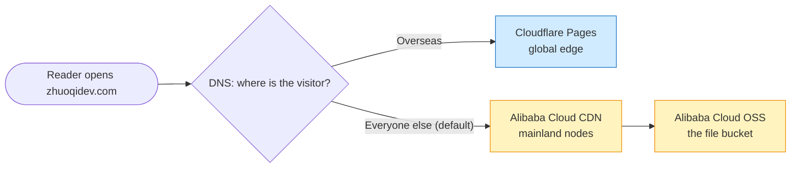
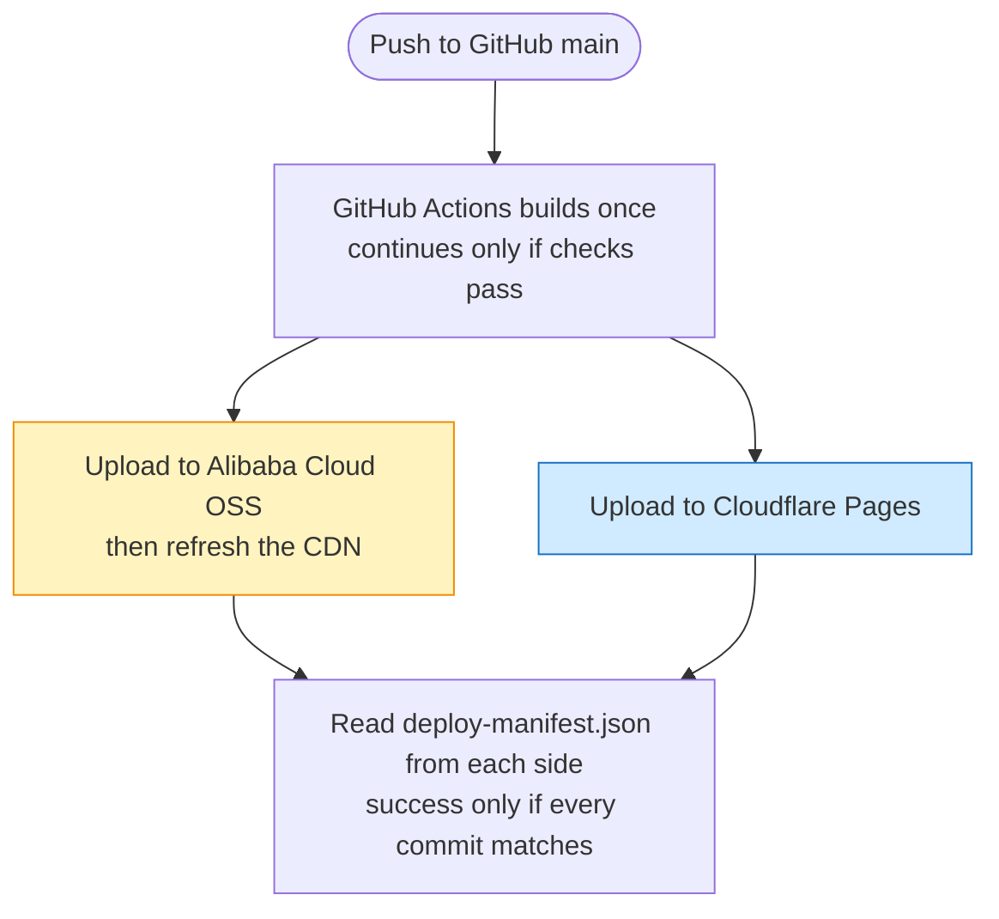

> [!NOTE]
> **This edition was rewritten on 2026-11-03 to match the current setup.** The May 2026 version described Hugo with the Blowfish theme. On 2026-10-07 the whole site moved to Astro 7 + TypeScript, and deployment, analytics and certificates changed with it; the old version also had one DNS line backwards. Costs below come from the Alibaba Cloud bills and the Cloudflare account API (checked 2026-11-03); timings come from GitHub Actions run records.

## The short version

- **One domain, two lines.** Visitors in China resolve to Alibaba Cloud CDN (backed by OSS); visitors abroad resolve to Cloudflare Pages. DNS is the phone book that can return different addresses depending on where the caller is, and Alibaba Cloud DNS lets you set a separate "overseas" line on its free plan, with everyone else on the default line.
- **It starts with an ICP filing.** Alibaba Cloud's mainland CDN nodes only serve domains registered with China's Ministry of Industry and Information Technology. You can file without renting a server: a ¥101 Function Compute resource pack serves as the "filing carrier".
- **Build once, publish twice, then check the commit.** Both sides receive the same build output (the `dist/` folder). After publishing, the pipeline reads a small file holding the commit hash from each side; if they disagree, the deploy fails.
- **About ¥207 a year.** Domain ¥90, filing resource pack ¥101, CDN traffic pack ¥14, OSS under ¥2; Cloudflare is free.
- **Good for** fully static sites with readers both in China and abroad (blogs, docs, portfolios); **not for** apps that need a server, or sites whose readers are almost all outside China (Cloudflare alone is enough). The filing takes three to five weeks, and readers in China make do until then.

```chart
{
  "type": "stats",
  "items": [
    {"label": "Yearly cost", "value": "¥207", "note": "From the May–October 2026 bills", "color": "seal"},
    {"label": "One deploy", "value": "about 4 min", "note": "Push to confirmed live on both sides", "color": "blue"},
    {"label": "Cloudflare spend", "value": "¥0", "note": "Pages, Functions and D1 all within the free tier", "color": "green"}
  ]
}
```

A few terms first:

| Term | What it means here |
|---|---|
| Static site generator (Hugo, Astro) | A tool that compiles Markdown articles into plain HTML, CSS and image files that can be served from anywhere, with no server program |
| OSS | Alibaba Cloud's object storage: a pay-as-you-go folder in the cloud where the site's files live |
| CDN | Caches files on nodes near readers; readers fetch from the nearest node, and OSS is only asked when a node lacks the file (a "fetch from origin") |
| Cloudflare Pages | Cloudflare's static hosting: upload a folder and it serves it from its global nodes at a `*.pages.dev` address, free for personal use |
| ICP filing / provincial authority | To run a site on servers or CDN in mainland China, the domain must first be registered with the Ministry of Industry and Information Technology; each province's communications administration reviews it |
| Function Compute | Alibaba Cloud's serverless service: upload code, it runs only on requests and bills by use; here it is just the filing ticket |
| D1 | Cloudflare's hosted SQLite database, where guestbook notes and visit counts live |
| GitHub Actions | GitHub's built-in automation: push code and it builds and publishes on GitHub's machines, free for public repositories |

---

## How the pieces connect

There are two paths to keep apart: **the path a reader's request takes**, and **the path a new article takes when I publish**.

For the reader, DNS first looks at where the visitor is.



For publishing, the site is built once and both sides get the same files.



Why not just one provider:

- **Cloudflare only**: free and fast worldwide, but slow and unreliable from mainland China, where about 70% of this site's readers are (computed on 2026-10-27 from the previous 30 days of Cloudflare analytics and Alibaba Cloud CDN logs, my own visits removed).
- **Alibaba Cloud only**: fast in China, but overseas readers detour to mainland nodes; and I also want Cloudflare's free functions and database for the guestbook (more below).

Both "slow"s are general experience from running sites in and outside China; I have not measured from multiple locations, so there are no numbers here.

---

## ICP filing without a server

Mainland CDN nodes only serve filed domains. The filing goes through a "hosting provider" such as Alibaba Cloud, which wants you to own a product there that can act as the "filing carrier", usually a server.

If you don't want a server, Alibaba Cloud's **Function Compute resource pack** counts too: an order of ¥100 or more comes with one filing service code (the voucher you enter when filing, proving you are an Alibaba Cloud customer). I bought the cheapest tier, a one-year pack of 1.2 million CU (Function Compute's unit of compute), list price ¥126, paid ¥101. Not one CU has been used. It is an entry ticket.

> [!WARNING]
> The pack expires on 2027-05-04. Alibaba Cloud's documentation does not say directly what happens if it is not renewed (checked 2026-11-03): it only says **an expired product can no longer issue new filing service codes**. Among Alibaba Cloud's [verification criteria](https://help.aliyun.com/document_detail/36997.html) for filed sites, the only one about hosting is that "the IP the filed domain currently resolves to must belong to the filing's access provider". My default line has always pointed at Alibaba Cloud CDN, which meets that. But that is an inference, not Alibaba Cloud's answer; whether to renew the ¥101 will be settled with Alibaba Cloud before it expires, and this note updated.

Alibaba Cloud's own review takes 1–5 working days and the provincial authority 10–20 working days, three to five weeks counting weekends — enough time to build the site in the meantime.

---

## Split DNS: two records, and mind which one is the default

In Alibaba Cloud DNS, one hostname can carry different records per line. Current configuration (checked 2026-11-03):

| Hostname | Line | Points to | Effect |
|---|---|---|---|
| `zhuoqidev.com` | Default | Alibaba Cloud CDN | China, and anywhere not matched by another line, goes to Alibaba Cloud |
| `zhuoqidev.com` | Overseas | `zhuoqidev.pages.dev` | Overseas goes to Cloudflare |
| `www.zhuoqidev.com` | Default | Alibaba Cloud CDN | Everyone goes to Alibaba Cloud |
| `api.zhuoqidev.com` | Default | `zhuoqidev.pages.dev` | Everyone goes to Cloudflare (guestbook and stats API) |

> [!TIP]
> The old edition said "overseas (default) → Cloudflare". **That was backwards**: the default line points to Alibaba Cloud and a separate overseas line points to Cloudflare. It matters for visitors the "mainland / overseas" check does not place: they get Alibaba Cloud, which at least never misroutes readers in China abroad.

`www` only has a default line, so overseas readers who type `www.` also detour to mainland nodes — a small wart I have left alone.

The domain does not have to move to Cloudflare: all DNS stays at Alibaba Cloud, and on Cloudflare's side `zhuoqidev.com` and `api.zhuoqidev.com` are simply added as custom domains of the Pages project. Once Alibaba Cloud's CNAME record (meaning "for this name, ask that name") points there, Cloudflare verifies ownership over HTTP and issues and renews the certificate itself (currently from Google Trust Services). On Alibaba Cloud's side, two accelerated domains (the domains served through the CDN) are added in the CDN console with the OSS bucket as origin (where a node fetches a file it lacks), and the CNAME it gives you goes into the default line.

---

## From Hugo to Astro

I researched the stack during the day on 2026-10-07 and the first answer was **stay on Hugo**: moving to Astro would take one to three weeks, and all it would buy was interactive components inside articles. The answer flipped the same day for one reason: **all of this site's code is now written by AI**, so a switching cost counted in human hours no longer applied. The old site also had real problems:

- English pages declared Chinese as their `lang`, the English RSS feed was empty, and search engines could not pair the two editions;
- 47 4K images totalled 244 MB, and the heaviest article weighed 14.5 MB.

Work started that evening and the new site went live the same day, which bore the premise out. Astro rather than a framework like Next.js, because two-line hosting can only serve static files, so most server-dependent features would go unused; and the text has to be in the static HTML so AI crawlers that do not run scripts can still read it.

The biggest risk of a migration is broken links. The 274 URLs of the old site were saved as a list, and every build checks that each still opens (moved articles get redirect pages). That check still runs on every deploy. This article is an example: its address `/en/posts/hugo-dual-cdn-blog/` did not change, only the content did.

---

## One deploy: build once, publish twice, check the commit

After a push to `main`, GitHub Actions runs these stages in order; a failure at any stage publishes nothing:

```steps
{
  "steps": [
    {"title": "Check", "text": "Type checks, lint, unit tests, then one full build."},
    {"title": "Verify output", "text": "Legacy URLs, internal links, anchors, language pairs, image sizes, and each article's Markdown copy for AI readers. Anything wrong stops the run."},
    {"title": "Stamp the commit", "text": "Write deploy-manifest.json into the output with this Git commit and the build time."},
    {"title": "Publish to Alibaba Cloud", "text": "Sync to OSS (deleting stale files), fix content types and cache headers, then refresh the CDN."},
    {"title": "Publish to Cloudflare", "text": "Upload the same dist/ to Cloudflare Pages."},
    {"title": "Cross-check", "text": "Bypass DNS, connect straight to both Alibaba Cloud CDN nodes and to pages.dev, read deploy-manifest.json; success only when all three show this commit. Then spot-check content types and cache headers."}
  ],
  "caption": "The six stages of deploy.yml (2026-11-03)"
}
```

Why the last stage bypasses DNS: GitHub's machines are in the US, so resolving `zhuoqidev.com` normally returns Cloudflare. Asking the domain alone would pass even if Alibaba Cloud never updated. The script connects to the Alibaba Cloud CDN node addresses directly and checks all three.

**It also shows where two lines go wrong most easily.** On 2026-10-11 and 10-13, after a package-manager switch, the Cloudflare step failed and the deploys did turn red; but the Alibaba Cloud step runs first and had already published. Readers in China saw new articles while readers abroad stayed on the last successful version from 10-09, and for two days nobody opened those two red runs. The lesson: when a two-line deploy fails, the two sides have probably already diverged, so a red run needs handling at once, not a fix that rides along with the next deploy.

### From 25 minutes to 4

Right after the migration, a dozen-odd deploys took 9 to 25 minutes each. The build was not the slow part; shipping files to Shenzhen was:

```chart
{
  "type": "dumbbell",
  "fmt": {"suf": " s"},
  "from": "Before (slowest run)",
  "to": "After",
  "rows": [
    {"label": "Sync to OSS", "sub": "3 → 32 parallel uploads", "from": 328, "to": 29},
    {"label": "Fix content types", "sub": "stop rewriting directory objects", "from": 137, "to": 4},
    {"label": "Install CJK fonts", "sub": "apt → direct download of a pinned version", "from": 811, "to": 4}
  ],
  "caption": "Single-step times before and after two changes on 2026-10-08 (GitHub Actions logs)"
}
```

- Alibaba Cloud's CLI uploads 3 files at a time by default. Each round trip from a US GitHub machine to Shenzhen takes about 0.25 seconds, so a thousand-odd files queued up for four to five and a half minutes; with 32 in parallel it takes 29 seconds.
- The build needs Chinese fonts to measure text width. Installing them with the system package manager apt sometimes took over ten minutes; downloading a pinned upstream version takes 4 seconds.

Recent deploys mostly take about 4 minutes from push to confirmed live on both sides.

---

## Four Alibaba Cloud OSS pitfalls

Cloudflare Pages works as soon as the upload finishes. Alibaba Cloud OSS is general object storage, and serving a website from it needs a few fixes. All four were hit for real:

| Symptom | Cause | Fix |
|---|---|---|
| Chinese `.md` and `llms.txt` render as mojibake | OSS sets content types without `charset=utf-8`, and has no type at all for `.md` | Re-upload those files with an explicit type and charset |
| three.js on the China line is about 4× the overseas size (581 KB vs 144 KB) | OSS only compresses a fixed list of types, and the `text/javascript` it assigns to `.js` is not on it | Label `.js` as `application/javascript`; enable only gzip on the CDN, whose brotli (another compression format) came out larger than its gzip |
| Changed headers stay old after a CDN refresh | A refresh only marks cached copies stale; the node asks OSS "has this changed?", an unchanged file gets "not modified" (HTTP 304), and the node keeps the old headers | Refresh the affected files one by one |
| Returning readers see an old version of an updated article | OSS sends no cache header for HTML, so browsers guess a lifetime from the last-modified time | Send `max-age=0, must-revalidate` on every file (Cloudflare's default), and a one-year cache on hashed asset names |

The last fix has a price: Alibaba Cloud CDN no longer caches HTML at the node and fetches it from OSS each time. Measured after the change on 2026-10-25, a request took 64–196 ms against 85–117 ms before, a few dozen milliseconds more at the slow end. I accept that so readers never see a stale article.

---

## Certificates: checked weekly, renewed at 30 days

Cloudflare manages its own certificates; the ones on Alibaba Cloud CDN must be uploaded by you. The site started with Alibaba Cloud's free DigiCert certificate; when it expired in August 2026 the free quota was used up, so it switched to Let's Encrypt (a free, non-profit certificate authority). Its certificates last 90 days today, [64 days from 2027-02-10 and 45 days from February 2028](https://letsencrypt.org/2026/10/07/64-day-certs), and manual renewal is bound to be forgotten, so renewal has to be automatic:

1. A scheduled job runs every Monday. It reads how many days the certificate on each CDN domain has left and exits if both have more than 30.
2. Below 30 days, acme.sh (an open-source script for requesting Let's Encrypt certificates) proves the domain is mine with a temporary record in Alibaba Cloud DNS, issues one certificate covering both the bare domain and `www`, and uploads it to both CDN domains.
3. It reads the certificate fingerprint back from both nodes; success only if both match what was uploaded, HTTPS works, and the temporary record is gone. The private key lives only in that run's temporary directory, never in a cache or the repository.

It has acted for real once: the old certificate expired on 10-31, the scheduled run on 2026-10-05 found 26 days left and issued a new one, which is valid on both domains until 2027-01-03 (read with openssl on 2026-11-03). Every weekly run since has been "renewal not needed", exiting in about ten seconds. Once certificates shrink to 45 days, "check weekly, renew below 30 days" still works; it just renews about every two weeks.

An interlude: in August 2026 a payment problem on the GitHub account stopped jobs from even getting a machine. For a while the certificate job ran on a VPS of my own (a "self-hosted runner" in GitHub's terms), and deploys were run by hand from a Mac. At the end of August everything moved back to GitHub-hosted machines (free for public repositories) and the VPS was retired.

---

## A little server code on a static site: guestbook and visit counts

The site itself is still static. The only server code is Cloudflare Pages Functions (small functions deployed with Pages), with data in Cloudflare's D1 database, currently 164 KB. Guestbook notes are held for review before they appear; visit counts store no IP. A person is counted once a day by hashing the IP together with a random string generated each day (the salt); the next day the salt and the hashes are deleted, after which nobody can recover the IP.

The hard part is the China line: **Alibaba Cloud CDN does not run functions**, and the stats beacon (a small request a page sends quietly when it opens, used for counting) that crosses the border to Cloudflare is often lost. Checking against CDN logs from 2026-10-09 to 10-11, the beacon recorded only a little over half of the actual readers each day. So the two lines are counted separately:

| | Overseas (Cloudflare) | China (Alibaba Cloud) |
|---|---|---|
| Crawlers | The function counts by User-Agent in real time | Counted each morning from the previous day's CDN logs |
| People | The page sends a beacon to `api.zhuoqidev.com` | The page requests `/hit.gif`, also counted from CDN logs and placed by province with an offline IP database |
| Delay | Real time | One day (Alibaba Cloud's logs arrive hours late) |

How a page knows which line served it: the Cloudflare function adds a `Server-Timing` marker to the response. The page script sends the beacon when it sees the marker and requests `/hit.gif` when it does not.

Free tier (Cloudflare docs, checked October 2026): 100,000 function requests a day; D1 allows 5 million rows read and 100,000 written a day. Static files bypass the functions (`_routes.json` excludes them) and use none of that, and the project is set so that if the allowance runs out, pages still load and only counting and the guestbook pause. On 2026-11-01 third-party analytics were cut down to Cloudflare Web Analytics; GA4 and Baidu Analytics were removed.

---

## What it actually costs per year

From the Alibaba Cloud bills (May–October 2026) and the Cloudflare account's subscriptions:

```chart
{
  "type": "bars",
  "fmt": {"pre": "¥"},
  "rows": [
    {"label": "Function Compute pack", "sub": "filing carrier, one year, list ¥126", "value": 101, "color": "seal"},
    {"label": "Domain", "sub": "¥270 for 3 years, to 2029-05", "value": 90, "color": "seal"},
    {"label": "CDN mainland traffic pack", "sub": "100 GB for a year, list ¥20", "value": 14, "color": "gold"},
    {"label": "OSS storage and traffic", "sub": "¥1.05 over six months, annualised", "value": 2, "color": "gold"},
    {"label": "Cloudflare", "sub": "Pages, Functions, D1, analytics", "value": 0, "color": "gray"}
  ],
  "caption": "About ¥207 a year in total (bills checked 2026-11-03)"
}
```

Is the traffic pack enough:

```chart
{
  "type": "meter",
  "fmt": {"suf": " GB"},
  "rows": [
    {"label": "CDN mainland traffic pack", "sub": "2026-05-04 to 2027-05-04", "value": 41.4, "max": 100, "color": "gold"}
  ],
  "caption": "41.4 GB used in six months, about 7 GB in the last month; it will not run out before it expires"
}
```

Certificates come from Let's Encrypt and Cloudflare at no cost. For scale: in the 30 days before 2026-10-27 the site had about 550 readers, and the China line uses about 7 GB a month.

The old edition said ¥212 because it used the traffic pack's list price and an estimate for OSS. The real fixed costs are **the domain and the filing ticket**; if traffic grows several times over, only the traffic line changes (once the pack runs out, traffic is billed by use; I have never got there).

---

## When this is worth doing

**Worth it:**
- Most readers are in China but some are abroad — a Chinese-language tech blog, an open-source documentation site.
- The site can be fully static (blog, docs, portfolio), and the occasional server feature can live in Cloudflare functions that the China line routes around.

**Skip it:**
- Readers are almost all outside China: use Cloudflare Pages alone, no filing, no cost.
- The site needs a server (logins, a database, live data): the whole point of two lines is that both sides only hold files. If you need a server, start with [What does it cost to run an app online each month?](/en/posts/model-gateway-cloudflare-vs-china-cloud/), which works out the bills for servers, serverless and edge functions.
- You can't wait for a filing: it takes three to five weeks, and until then readers in China have to make do with Cloudflare.
- A company or team site: the architecture is the same, but the filing goes through the company as the applicant with more paperwork, and a private repository pays for GitHub Actions minutes beyond the free allowance. I have not been through either myself.

> One domain, two lines: **the money goes to the tickets (domain + filing), the care goes to consistency.** As long as every deploy checks the same commit on both sides, two lines are as easy to live with as one.
