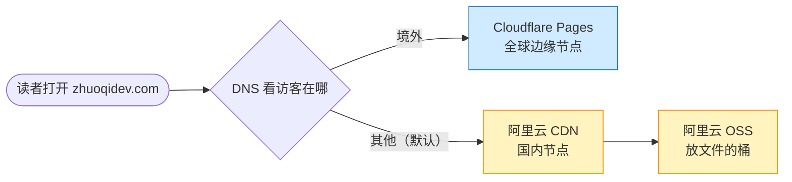
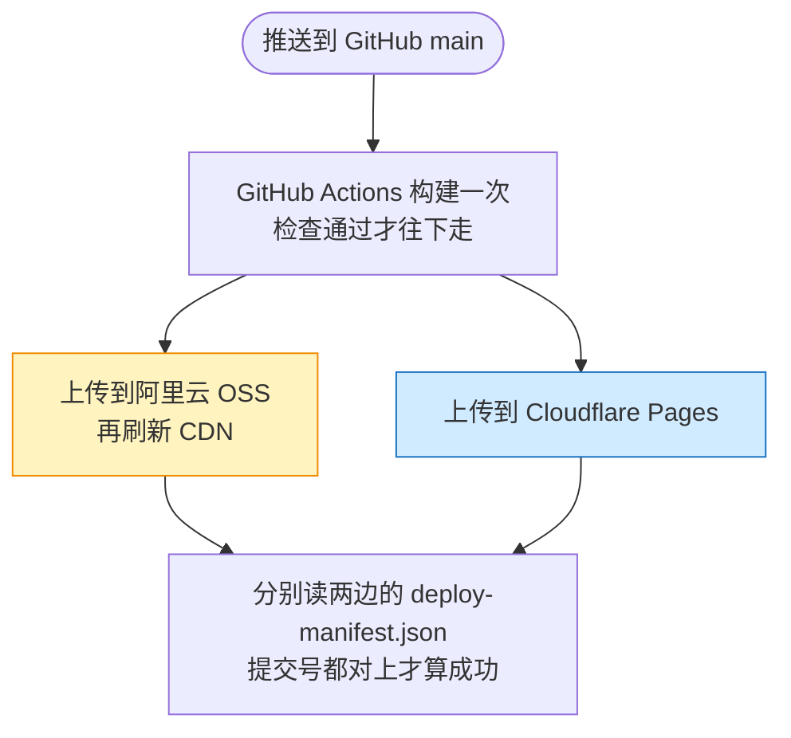

> [!NOTE]
> **这篇是 2026-11-03 按现状重写的版本。** 2026-05 首版写的是 Hugo + Blowfish 主题；2026-10-07 整站换成 Astro 7 + TypeScript，部署、统计、证书都跟着变了，旧文里的 DNS 线路也写反了一处。下面的费用来自阿里云账单和 Cloudflare 账户接口（2026-11-03 查），时间来自 GitHub Actions 的运行记录。

## 先说结论

- **一个域名，两条线。** 国内访客解析到阿里云 CDN（背后是 OSS），海外访客解析到 Cloudflare Pages。DNS 是按访客所在地返回不同地址的「电话簿」，阿里云云解析的免费版就能给「境外」单独设一条线路，其余访客走默认线路。
- **前提是备案。** 想用阿里云的国内 CDN 节点，域名必须先在工信部备案；不买服务器也能备，靠一个 ¥101 的函数计算资源包当「备案载体」。
- **一次构建，两边发布，再核对提交号。** 两边拿的是同一份构建产物（`dist/` 文件夹），发完以后分别去两边读一个写着提交号的小文件，对不上就算部署失败。
- **一年约 ¥207。** 域名 ¥90、备案资源包 ¥101、CDN 流量包 ¥14、OSS 几毛到两块；Cloudflare 免费。
- **适合**纯静态、读者国内国外都有的站（博客、文档、作品集）；**不适合**离不开服务器的应用，或读者几乎全在海外的站（只用 Cloudflare 就够）。备案要等三到五周，期间国内只能先凑合。

```chart
{
  "type": "stats",
  "items": [
    {"label": "一年开销", "value": "¥207", "note": "照 2026-05 至 10 月账单折算", "color": "seal"},
    {"label": "一次部署", "value": "约 4 分钟", "note": "推送到两边都确认上线", "color": "blue"},
    {"label": "Cloudflare 花费", "value": "¥0", "note": "Pages、函数、D1 都在免费额度内", "color": "green"}
  ]
}
```

几个词先说清楚：

| 词 | 在这篇里指什么 |
|---|---|
| 静态站生成器（Hugo、Astro） | 把 Markdown 文章编译成一堆 HTML、CSS、图片文件的工具，产物放哪都能打开，不需要服务器程序 |
| OSS | 阿里云的对象存储，可以理解成按量收费的云端文件夹，网站文件放在这里 |
| CDN | 把文件缓存到离读者近的节点上，读者从最近的节点取，OSS 只在节点没有时才被访问（叫「回源」） |
| Cloudflare Pages | Cloudflare 的静态网站托管：上传文件夹，它放到全球节点上并给一个 `*.pages.dev` 地址，个人用免费 |
| 备案 / 管局 | 在中国大陆的服务器或 CDN 上开网站，域名要先向工信部登记，由各省通信管理局（管局）审核 |
| 函数计算 | 阿里云的 Serverless 服务：上传一段代码，有请求才运行、按量计费；这里只拿它当备案门票 |
| D1 | Cloudflare 的托管 SQLite 数据库，留言和访问计数存在这里 |
| GitHub Actions | GitHub 自带的自动化任务：代码推上去，它在 GitHub 的机器上构建并发布，公开仓库免费 |

---

## 整体是怎么连起来的

要分清两条路：**读者打开网页走的路**，和**我发布新文章走的路**。

读者这边：DNS 先看访客在哪。



发布这边：只构建一次，两边拿到的是同一批文件。



为什么不只用一家：

- **只用 Cloudflare**：免费、全球快，但国内访问慢且不稳；而我这站约七成读者在国内（2026-10-27 按此前 30 天的 Cloudflare 统计和阿里云 CDN 日志算的，去掉了我自己）。
- **只用阿里云**：国内快，海外读者绕回国内节点也慢；而且我还需要 Cloudflare 的免费函数和数据库来跑留言板（后面讲）。

这两条「慢」是做国内外网站的一般经验，我没有做过多地测速，所以这里不给数字。

---

## 备案：不买服务器怎么拿到备案码

国内的 CDN 节点只给备案过的域名用。备案要在阿里云这样的「接入商」名下办，接入商要求你在它那儿有一个能当「备案载体」的产品，通常是服务器。

不想买服务器的话，阿里云的**函数计算资源包**也算：订单满 ¥100 就给一个备案服务码（提交备案时要填的凭证，证明你是阿里云的用户）。我买的是最便宜的一档，120 万 CU（函数的计算量单位）的年包，原价 ¥126，实付 ¥101。这 120 万 CU 到现在一点没用，它只是一张门票。

> [!WARNING]
> 这个资源包 2027-05-04 到期。到期不续会怎样，阿里云文档没有直接写（2026-11-03 查）：文档只说**过期的产品不能再申请新的备案服务码**；而阿里云对已备案网站的[核查标准](https://help.aliyun.com/document_detail/36997.html)里，和接入有关的只有一条，「备案域名当前解析到的 IP 要属于备案时的接入商」。我的域名默认线路一直指阿里云 CDN，按这条标准不受影响。但这是推断，不是阿里云的答复；续不续这 ¥101，到期前找阿里云确认后再在这里更新。

时间上，阿里云初审 1–5 个工作日，管局审核 10–20 个工作日，算上周末前后三到五周，正好拿来把网站先搭好。

---

## DNS 分线路：两条记录，注意谁是默认

在阿里云云解析里，同一个主机名可以按线路填不同的记录。我现在的配置（2026-11-03 实查）：

| 主机名 | 线路 | 指向 | 结果 |
|---|---|---|---|
| `zhuoqidev.com` | 默认 | 阿里云 CDN | 国内和其他没单独配的地方走阿里云 |
| `zhuoqidev.com` | 境外 | `zhuoqidev.pages.dev` | 海外走 Cloudflare |
| `www.zhuoqidev.com` | 默认 | 阿里云 CDN | 所有人都走阿里云 |
| `api.zhuoqidev.com` | 默认 | `zhuoqidev.pages.dev` | 所有人都走 Cloudflare（留言和统计接口） |

> [!TIP]
> 旧版这里写的是「境外（默认）→ Cloudflare」，**写反了**：默认线路指的是阿里云，境外线路单独指向 Cloudflare。差别在于那些不在「境内 / 境外」判断范围里的访客：默认给阿里云，至少保证国内用户不会被错分到海外。

`www` 只配了默认线路，所以海外读者打开 `www.` 也会绕到国内节点，这是我留着没管的小毛病。

域名不用转到 Cloudflare：DNS 全留在阿里云，Cloudflare 这边只要在 Pages 项目里把 `zhuoqidev.com` 和 `api.zhuoqidev.com` 加成「自定义域」。阿里云那条 CNAME 记录（意思是「这个域名去问那个域名」）指过去以后，Cloudflare 通过 HTTP 验证域名归属，自动签发并续期证书（现在是 Google Trust Services 签的）。阿里云这边则是在 CDN 控制台加两个加速域名（要走 CDN 的域名），源站（节点没有文件时去哪取）选 OSS 桶，再把阿里云给的 CNAME 地址填进默认线路。

---

## 从 Hugo 换到 Astro

2026-10-07 白天我做了一次技术栈调研，第一版结论是**留在 Hugo**：换 Astro 估计要一到三周，换来的只是「正文里能写交互组件」。当天结论就翻了，原因只有一个：**这个站的代码现在全由 AI 写**，换栈成本按人写代码算的前提不成立了。再加上旧站本身的问题：

- 英文页的 `lang` 写成了中文，英文 RSS 是空的，搜索引擎认不出中英对应关系；
- 47 张 4K 配图共 244 MB，最重的一篇文章 14.5 MB。

当晚开工，当天新站就上线了，正好印证了这个前提。选 Astro 而不是 Next.js 这类框架，是因为双线部署只能放纯静态文件，依赖服务器的功能大半用不上；正文也必须写在静态 HTML 里，AI 爬虫不跑脚本也能读到。

换栈最怕的是旧链接失效。迁移时把旧站 274 个网址存成清单，每次构建后逐个检查它们还能打开（文章换了地址的就生成跳转页），这道检查现在还在每次部署里跑。这篇文章自己就是例子：网址 `/posts/hugo-dual-cdn-blog/` 一个字没改，只是内容换了。

---

## 一次部署：构建一次，两边发布，再核对提交号

推送到 `main` 以后，GitHub Actions 按这个顺序走，任何一步失败都不会发布：

```steps
{
  "steps": [
    {"title": "检查", "text": "类型检查、代码规范、单元测试，再完整构建一次。"},
    {"title": "核对产物", "text": "旧网址、站内链接、锚点、中英对应、图片尺寸、每篇文章给 AI 读的 Markdown 副本，一项不对就停。"},
    {"title": "写提交号", "text": "往产物里写一个 deploy-manifest.json，记下这次的 Git 提交号和构建时间。"},
    {"title": "发阿里云", "text": "同步到 OSS（删掉旧文件），补上文件类型和缓存头，再刷新 CDN。"},
    {"title": "发 Cloudflare", "text": "把同一个 dist/ 上传到 Cloudflare Pages。"},
    {"title": "两边核对", "text": "绕过 DNS 直连阿里云的两个 CDN 节点和 pages.dev，读 deploy-manifest.json，三处的提交号都等于这次的才算成功；再抽查文件类型和缓存头。"}
  ],
  "caption": "deploy.yml 的六个阶段（2026-11-03）"
}
```

最后一步为什么要「绕过 DNS」：GitHub 的机器在美国，正常解析 `zhuoqidev.com` 拿到的是 Cloudflare。只请求域名的话，阿里云那边没更新也会显示通过。所以脚本直接连阿里云 CDN 的节点地址，三处分别核对。

**它也说明了双线最容易出事的地方。** 2026-10-11 和 10-13 的两次部署，换了包管理器后 Cloudflare 那一步失败，部署确实标了红；但阿里云那步排在前面、已经发出去了。结果国内读者看到新文章，海外读者停在 10-09 最后一次成功的版本，两天里那两个红叉都没人点开看。教训：双线部署失败时，两边很可能已经不一致，红叉要当场处理，不能等下次部署顺带修好。

### 从 25 分钟到 4 分钟

刚迁完那两天，十几次部署每次要 9 到 25 分钟。慢不在构建，而在往深圳传文件：

```chart
{
  "type": "dumbbell",
  "fmt": {"suf": " 秒"},
  "from": "提速前（最慢一次）",
  "to": "提速后",
  "rows": [
    {"label": "同步到 OSS", "sub": "并发 3 → 32", "from": 328, "to": 29},
    {"label": "补文件类型", "sub": "不再重写目录对象", "from": 137, "to": 4},
    {"label": "装中文字体", "sub": "apt → 直接下载固定版本", "from": 811, "to": 4}
  ],
  "caption": "2026-10-08 两次修改前后的单步耗时（GitHub Actions 日志）"
}
```

- 阿里云命令行工具默认一次只传 3 个文件。从美国的 GitHub 机器到深圳每次往返约 0.25 秒，一千多个文件排着队传，光这一步就要四到五分多钟；调到 32 个并发后 29 秒。
- 构建时要用中文字体量文字宽度，原来用系统包管理器 apt 装，偶尔一装十几分钟；改成从上游固定版本直接下载，4 秒。

现在最近几次部署从推送到两边都确认上线，大多在 4 分钟左右。

---

## 阿里云 OSS 的四个坑

Cloudflare Pages 上传完就能用；阿里云 OSS 是通用的对象存储，当网站用要自己补几处。下面四个都是真踩过的：

| 现象 | 原因 | 修法 |
|---|---|---|
| 中文 `.md`、`llms.txt` 在浏览器里乱码 | OSS 设类型时不带 `charset=utf-8`，`.md` 干脆没有类型 | 上传后对这几类文件重传一遍，显式写类型和 charset |
| 国内线的 three.js 约是海外的 4 倍大（581 KB 对 144 KB） | OSS 只压缩固定名单里的类型，`.js` 被标成的 `text/javascript` 不在名单里 | 把 `.js` 改标成 `application/javascript`；CDN 只开 gzip，它的 brotli（另一种压缩格式）压出来比 gzip 还大 |
| 改了响应头，刷新 CDN 后还是旧的 | 刷新只把缓存标成过期；节点回 OSS 问「文件变了吗」，文件没变就得到「没变」（HTTP 304），节点继续用旧头 | 改头的那批文件按文件逐个刷新 |
| 更新了文章，老读者打开还是旧版 | OSS 不给 HTML 发缓存头，浏览器按「上次修改时间」自己猜能缓存多久 | 每个文件都带 `max-age=0, must-revalidate`（和 Cloudflare 默认一致），带哈希文件名的资源另给一年缓存 |

最后一条有代价：阿里云 CDN 从此不在节点上缓存 HTML，每次都回 OSS 取一次。2026-10-25 改完实测，一次请求 64–196 毫秒，改之前 85–117 毫秒，慢的那头多几十毫秒。为了不让读者看旧文章，我认这个账。

---

## 证书：每周检查，剩 30 天自动续

Cloudflare 的证书它自己管；阿里云 CDN 上的证书要自己上传。最早用阿里云送的 DigiCert 免费证书，2026-08 到期时免费额度已经用完，改用 Let's Encrypt（免费的公益证书机构）。它的证书现在有效期 90 天，[2027-02-10 起缩短到 64 天、2028-02 再缩到 45 天](https://letsencrypt.org/2026/10/07/64-day-certs)，手动续迟早会忘，所以必须自动续：

1. 每周一定时跑一次，先读两个 CDN 域名上证书还剩几天，都超过 30 天就直接退出。
2. 不够 30 天时，用 acme.sh（申请 Let's Encrypt 证书的开源脚本）在阿里云 DNS 里加一条临时记录证明域名归我，签一张同时覆盖根域和 `www` 的证书，上传到两个 CDN 域名。
3. 去两个节点读回证书指纹，和刚上传的完全一致、HTTPS 正常、临时记录已删，才算成功。私钥只在这次运行的临时目录里，不进缓存也不进仓库。

它真正出手过一次：旧证书 10-31 到期，2026-10-05 的定时任务发现只剩 26 天，签了新证书，现在两个域名上的证书有效期到 2027-01-03（2026-11-03 用 openssl 读的）。之后每周的运行都是「不需要续」，十几秒就退出。证书缩到 45 天以后，这套「每周看一次、剩不到 30 天就续」的规则照样够用，只是大约每两周续一次。

中间有段插曲：2026-08 GitHub 账户的付款问题让任务连机器都分配不到，我一度把证书任务搬到一台自己的 VPS 上跑（GitHub 叫「自托管运行器」），连部署都改成在 Mac 上手动发。8 月底所有任务又迁回 GitHub 托管的机器（公开仓库用它不收费），VPS 退役。

---

## 静态站加一点服务端：留言板和访问统计

站点本身还是纯静态，唯一的服务端代码是 Cloudflare Pages Functions（跟着 Pages 部署的小函数），数据存在 Cloudflare 的 D1 数据库里，目前 164 KB。留言先审后显示；访问统计不存 IP；同一个人当天只算一次，靠的是把 IP 和一串每天随机生成的字符（盐）一起算成哈希，第二天连盐带哈希一起删，之后谁也还原不出 IP。

难点在国内线：**阿里云 CDN 不跑函数**，而页面往 Cloudflare 发的统计信标（页面打开时悄悄发出的一个小请求，用来计数），从国内跨境经常丢。2026-10-09 至 10-11 我拿 CDN 日志对过，信标每天只记到实际读者的一半多一点。所以两条线分开数：

| | 海外（Cloudflare） | 国内（阿里云） |
|---|---|---|
| 爬虫 | 函数按 User-Agent 实时数 | 每天早上读前一天的 CDN 日志数 |
| 真人 | 页面发信标到 `api.zhuoqidev.com` | 页面请求一个 `/hit.gif`，同样从 CDN 日志里数，用离线 IP 库查到省份 |
| 延迟 | 实时 | 晚一天（阿里云日志要几小时才出来） |

页面怎么知道自己是从哪条线来的：Cloudflare 那边的函数会在响应里加一个 `Server-Timing` 标记，页面脚本看到它就发信标，看不到就请求 `/hit.gif`。

免费额度（Cloudflare 文档，2026-10 查）：函数每天 10 万次请求，D1 每天读 500 万行、写 10 万行。静态文件不经过函数（`_routes.json` 排除掉了），所以不占额度；项目设成用完额度时页面照常打开，只是计数和留言暂停。第三方统计 2026-11-01 只留了 Cloudflare Web Analytics，GA4 和百度统计都删了。

---

## 一年到底花多少钱

照阿里云账单（2026-05 至 10 月）和 Cloudflare 账户的订阅记录：

```chart
{
  "type": "bars",
  "fmt": {"pre": "¥"},
  "rows": [
    {"label": "函数计算资源包", "sub": "备案载体，一年，原价 ¥126", "value": 101, "color": "seal"},
    {"label": "域名", "sub": "¥270 买了 3 年，到 2029-05", "value": 90, "color": "seal"},
    {"label": "CDN 内地流量包", "sub": "100 GB 一年，原价 ¥20", "value": 14, "color": "gold"},
    {"label": "OSS 存储和流量", "sub": "半年合计 ¥1.05，按一年算", "value": 2, "color": "gold"},
    {"label": "Cloudflare", "sub": "Pages、函数、D1、统计", "value": 0, "color": "gray"}
  ],
  "caption": "合计约 ¥207 / 年（2026-11-03 查账单）"
}
```

流量包够不够用：

```chart
{
  "type": "meter",
  "fmt": {"suf": " GB"},
  "rows": [
    {"label": "CDN 内地流量包", "sub": "2026-05-04 至 2027-05-04", "value": 41.4, "max": 100, "color": "gold"}
  ],
  "caption": "半年用了 41.4 GB，最近一个月约 7 GB，到期前用不完"
}
```

证书用 Let's Encrypt 和 Cloudflare 自带的，都不花钱。流量的参照：2026-10-27 前 30 天全站约 550 位读者，国内线每月约 7 GB。

和旧版的 ¥212 比，差在旧版按原价写了流量包、按估算写了 OSS。真正的固定开销是**域名和备案门票**，访问量再翻几倍，变的也只是流量这一项（流量包用完按量计费，我还没用到过）。

---

## 什么时候值得这样做

**值得：**
- 读者一大半在国内，又有海外读者，比如中文技术博客、开源项目文档站。
- 网站能做成纯静态（博客、文档、作品集），偶尔要一点服务端功能，可以放到 Cloudflare 的函数里，国内线绕过去。

**别这样做：**
- 读者几乎全在海外：只用 Cloudflare Pages，不用备案，一分钱不花。
- 网站离不开服务器（登录、数据库、实时数据）：双线的意义就是两边都只放文件；要服务器，先看[上线一个应用每月要花多少钱](/posts/model-gateway-cloudflare-vs-china-cloud/)，那篇把服务器、Serverless、边缘函数的账拆开算过。
- 不想等备案：备案要三到五周，期间国内只能先用 Cloudflare 凑合。
- 公司或团队的站：架构一样，但备案要用公司主体办、材料更多；仓库是私有的话，GitHub Actions 超出免费分钟数要付费。这两点我没亲自走过。

> 一套域名两条线，**花钱的是门票（域名 + 备案），费心的是一致性**：只要每次部署都去两边核对同一个提交号，双线就和单线一样省心。
