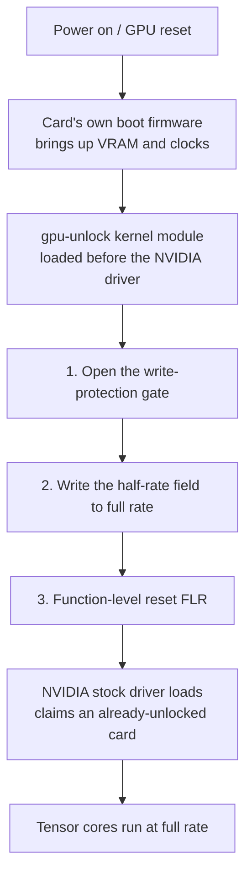

```opener
{
  "word": "½ → 1×",
  "headline": "Same GPU, same power draw, BF16 goes from 25 to 39 TFLOPS.",
  "sub": "My RTX 3060 laptop, dense matrix multiply measured before and after a gpu-unlock cold boot:",
  "readouts": [
    {"label": "BF16 locked", "value": "25 TFLOPS"},
    {"label": "BF16 unlocked", "value": "39 TFLOPS"},
    {"label": "Power", "value": "~105 W both"}
  ],
  "note": "RTX 3060 Laptop 6GB · kernel 7.0.0-38 · driver 595.99.02 · 8192³ dense GEMM · measured 2026-10-29"
}
```

*This is for anyone with a consumer NVIDIA card who uses it for local training, fine-tuning or image generation, and for anyone curious why one piece of silicon gets sorted into tiers. You do not need to know GPU microarchitecture; I build the mental model before the details. Every performance number comes from one of my own machines, an RTX 3060 Laptop (6GB), measured 2026-10-29; numbers from the project and the community I flag as such, to be read as reference. The exploit details the unlock relies on are out of scope here; I link the author's write-up for those.*

---

## The conclusion first (version and scope)

- **What it frees**: NVIDIA caps **FP16 / BF16 / TF32 tensor math with FP32 accumulation** at half rate on consumer (GeForce) cards, to separate them from professional cards built on the same silicon. [gpu-unlock](https://github.com/Zagitta/gpu-unlock), an open-source kernel module, lifts that cap before the GPU driver loads — no patched driver, no VBIOS flash.
- **Measured on my machine**: dense matrix multiply +55% to +65%, a small BF16 training run +40%. **Gaming, ordinary FP32 math, and quantized (INT8) models do not change at all** — they were never capped.
- **Scope**: stable on RTX 30 (Ampere); RTX 20 (Turing) and 40 (Ada) are experimental. **RTX 50 (Blackwell) cannot be unlocked**; I explain why below. Linux, with Secure Boot off or the module self-signed.
- **This is not overclocking**: it does not touch clocks, power limits or voltage, and outputs are bit-identical, so there is no stability or image-quality risk. Laptops carry extra costs, covered in the last section.

---

## Which part of the hardware is capped: the tensor core's issue cadence

Correct one instinct first: **what is held back is not the tensor core itself, but how often it is fed an instruction.**

A GPU's compute is nested. A card holds a dozen-plus **SMs (streaming multiprocessors)**. Inside each SM are **CUDA cores** (game shading, ordinary float), **tensor cores** (matrix multiply), and a **dispatch unit** that issues at most one instruction per clock to the execution units.

What NVIDIA does on consumer cards is make the dispatch unit issue **one instruction every two clocks** for a specific class of operations. The tensor core can physically run at full rate (the same silicon in a professional card does), but it sits idle half the time waiting for work, so effective throughput halves.

An SM has a config register split into small fields, one per operation class (one governs ordinary float, one the FP16/BF16 matrix path, one the TF32 matrix path, one integer matrix math). On consumer cards, **only the FP16/BF16 and TF32 matrix fields are set to half**; the rest are already at full. Hold onto that — it predicts everything below about what speeds up and what does not.

> [!NOTE]
> This explains a key observation: the speedup does not come from higher clocks or more power. The bottleneck was the issue cadence all along, not compute, clocks or watts — the next section's measurements nail this down.

---

## Measured on my machine: same power, lower clock

On my own RTX 3060 Laptop (6GB, GA106M), I ran dense matrix multiply before and after unlocking (cuBLAS, FP32 accumulation, median), on AC power throughout, power pinned at about 105 W.

```chart
{
  "type": "bars",
  "fmt": {"suf": " TFLOPS", "digits": 1},
  "rows": [
    {"label": "BF16 · locked", "value": 25.4, "color": "gray"},
    {"label": "BF16 · unlocked", "value": 41.9, "color": "seal"},
    {"label": "FP16 · locked", "value": 25.5, "color": "gray"},
    {"label": "FP16 · unlocked", "value": 41.7, "color": "seal"},
    {"label": "TF32 · locked", "value": 12.6, "color": "gray"},
    {"label": "TF32 · unlocked", "value": 20.4, "color": "seal"}
  ],
  "legend": [{"color": "seal", "label": "unlocked"}, {"color": "gray", "label": "locked"}],
  "caption": "RTX 3060 Laptop 6GB, 4096³ dense matrix multiply, throughput before and after (higher is better)."
}
```

The telling part is the two numbers beside it: **power stayed at about 105 W both times, but the SM clock actually dropped from about 1760 MHz to about 1470 MHz, while throughput nearly doubled.** Same watts, lower clock, almost twice the work — that is exactly what "the issue cadence was lifted" looks like: the tensor core stops waiting and finishes the work without needing a higher clock. If you install this and the clock does not drop while throughput rises, the unlock did not take.

On a real training run — a 6-layer Transformer in BF16 mixed precision:

```chart
{
  "type": "bars",
  "fmt": {"suf": " token/s", "digits": 0},
  "rows": [
    {"label": "locked", "value": 31457, "color": "gray"},
    {"label": "unlocked", "value": 44116, "color": "seal"}
  ],
  "caption": "BF16 mixed-precision training of a 6-layer Transformer (d=1024, seq=512, batch=16), tokens per second, +40%. Final loss matched to five decimals across the two runs — the speed changed, the result did not."
}
```

---

## Only these operation classes speed up

Same machine, five operation classes side by side, and its character shows at a glance:

```chart
{
  "type": "bars",
  "fmt": {"suf": "%", "digits": 0},
  "rows": [
    {"label": "BF16 matrix", "value": 65, "color": "seal"},
    {"label": "FP16 matrix", "value": 64, "color": "seal"},
    {"label": "TF32 matrix", "value": 63, "color": "seal"},
    {"label": "INT8 matrix (control)", "value": 0, "color": "gray"},
    {"label": "FP32 plain float (control)", "value": 0, "color": "gray"}
  ],
  "legend": [{"color": "seal", "label": "was capped"}, {"color": "gray", "label": "never capped"}],
  "caption": "4096³ dense matrix multiply, gain after unlock. Only the capped FP16/BF16/TF32 classes speed up."
}
```

One more clean tell: before unlocking, my INT8 matrix multiply was **about 2.9×** the BF16 rate; after, it dropped to **about 1.9×**. On a full-rate Ampere chip INT8 should be exactly 2× BF16 — the unlock restored that ratio, which means BF16 really had been cut in half.

So, who benefits and who does not:

- **Gets faster**: PyTorch BF16/FP16 training and fine-tuning, diffusion image generation (SDXL, Flux), FlashAttention, and the **prefill** stage of LLMs (reading the prompt). All of these run the matrix classes that were freed.
- **Does not get faster**: game frame rates (FP32 graphics pipeline, never capped), LLM **token generation** (bound by memory bandwidth, not compute), quantized GGUF in llama.cpp (INT8/INT4, never capped), and ordinary FP32 math.

> [!TIP]
> If you want more game FPS, this project won't help — it is not overclocking. It frees **half-precision compute for local AI.**

The project README lists a long table of per-card gains from RTX 3060 to 4090 (+65% up to a doubling), plus vLLM prefill and LoRA fine-tuning gains. Those are author- and community-reported — read them as reference; only the numbers marked "measured on my machine" here are mine.

---

## How the cap is opened at boot

As noted, that speed field sits behind a **write-protection gate**: once the system is running, you cannot write it from the driver side. So you have to act in the window when the card has not yet been claimed by the ordinary driver and its own boot firmware is still running.

gpu-unlock is a Linux kernel module loaded **before the NVIDIA driver**. In that boot window it does three things, then hands the card back to the stock driver:



It opens the gate using a **known flaw** in the card's boot firmware (the same one behind the earlier NVIDIA CMP mining-card unlocks). Because this happens before the driver, there is **no patched driver, no VBIOS flash, and nothing to redo when the driver updates**. How the flaw is actually exploited is out of scope here — for the deep dive, see the author's [*How Ampere was unlocked*](https://github.com/Zagitta/gpu-unlock/blob/main/docs/How%20Ampere%20was%20unlocked.md).

This brings one hard constraint: **it must be a cold boot.** Once the stock driver has touched the card, the window is closed and the module refuses, telling you to power off first. Laptops especially — the discrete GPU powers down when idle, and a power-down resets the unlock. That is the pitfall covered below.

---

## Why RTX 50 cannot be unlocked

Correct a common misreading first: **NVIDIA did not remove the cap on the new cards.** The half-rate field is still there on Blackwell (RTX 50), measured at about 51% of full rate. What changed is that **the unlocking method can no longer get in.**

The method depends on a very specific chain: a flaw in a signed boot-firmware blob on the card's security processor, and that flaw became findable only because NVIDIA once shipped a debug build of that firmware encrypted with a public test key. Turing / Ampere / Ada (the 20/30/40 series) **share this boot chain**, so one method covers all three.

Blackwell replaced the whole chain: the root of trust moved to a different security processor, and the old firmware was dropped from the boot flow — the code the exploit lived in simply does not run on the new cards, and there is no leaked new blob to work from. The author's FAQ says plainly that Blackwell is "not supported and unlikely to happen."

> [!NOTE]
> In one line: the older cards are unlockable because of two historical accidents — three generations sharing one boot chain, and one leaked debug firmware. The new cards switched to a cleaner secure-boot architecture that welds the path shut in advance. **The lock is still there; the key is gone.**

---

## This kind of bypass is not new

NVIDIA tiers one generation of silicon with firmware and drivers, and the community finds ways around it; this has gone back and forth for years. gpu-unlock is just the latest:

| What was locked | How it was bypassed at the time |
| --- | --- |
| GeForce ↔ Quadro professional features | Soft-mod the device ID so the driver sees a game card as a pro card (earlier still, Radeon→FireGL) |
| vGPU virtualization on consumer cards | `vgpu_unlock`, freeing the virtualization reserved for pro cards |
| **LHR mining throttle** (closest to this one — a direct compute lock) | Third-party miners bypassed ~70%, then fully; NVIDIA even shipped one driver that undid it by accident, and finally **quietly removed the throttle itself** in a later driver |
| CMP mining cards (VRAM and display outputs locked) | `cmpunlocker` — **the very exploit gpu-unlock reuses** |

The common thread: none of these turn a small card into a big one. They take an ability **the same silicon already had, which was held back on purpose, and put it back.** The pattern is clear too: the vendor tends to fix one path and have the next one found, or give up like with LHR — but sometimes, as with Blackwell, welds the path shut in a new architecture.

---

## Should you install it: costs and rollback

It does not touch clocks, power limits or voltage, and outputs are bit-identical, so there is **none of overclocking's stability or image-quality risk**; if it fails, the stock driver still loads and the worst case is simply no unlock. But there are real costs, especially on a laptop:

- **Secure Boot must be off**, or the kernel module self-signed, or it will not load.
- **On a laptop the discrete GPU must stay powered** (`NVreg_DynamicPowerManagement=0x00`), or an idle power-down resets the unlock. The cost is **worse battery life and more heat**. Mine also needed `NVreg_GpuInitOnProbe=1`, or the driver's init timing would re-cap the card (see project issue #135).
- **It does not add VRAM.** 6GB stays 6GB; the size of model you can run is unchanged, the same work just runs faster.
- **The current main branch is missing some laptop IDs.** My RTX 3060 Laptop (`10de:2520`) was dropped in a refactor, so you have to add the ID back before building (upstream PR #212 does exactly this).
- **Rollback is easy**: press `e` in the GRUB menu at boot and delete the kernel parameter for a one-off un-unlocked boot; to turn it off for good, remove the kernel parameter and the modprobe config, uninstall the two packages, and rebuild the initramfs.

When it is worth it: you **regularly use this consumer NVIDIA card for BF16/FP16 training, fine-tuning or diffusion image generation**, and you accept the costs above. When to skip it: you mainly **game**, or you only run quantized models in llama.cpp for token generation — it helps neither.

---

## How to measure it yourself

Don't trust any single number (mine included); run it yourself. The essentials:

- **Measure the capped classes**: FP16/BF16/TF32 dense matrix multiply with FP32 accumulation (turn off `allow_fp16/bf16_reduced_precision_reduction` in PyTorch), plus FP32 and INT8 as controls — the controls staying flat is what proves you measured the unlock and not some other drift.
- **Log SM clock and power at the same time**: the signature of the unlock is "same power, clock flat or lower, throughput up." Throughput alone rising could be something else (a sneaky clock bump).
- **On a laptop, stay on AC and let it idle a few minutes first**; thermal throttling will muddy the numbers.
- After unlocking, `journalctl -k -b | grep gpu_unlock` should show `unlocked`.

The benchmark script I used (PyTorch, about 4 minutes, free) is in the appendix.

---

**One line to close**: gpu-unlock is not overclocking, it adds no frames, and it does not turn your card into a different one. It just puts the half-speed tensor cores — the ones NVIDIA pressed down on consumer silicon to protect its pricey pro lineup — **back where they were.** That's all it does; but for anyone doing local AI on a consumer card, that "all" is a real, near-doubling.

<details>
<summary>Appendix: benchmark script and full data</summary>

The benchmark script is `bench_tensor.py` in my research repo (PyTorch, GEMM 4096/8192 + BF16 training, logging clock/power automatically). Full data from this machine (RTX 3060 Laptop 6GB, kernel 7.0.0-38, driver 595.99.02, 2026-10-29, on AC at ~105 W):

| Metric (4096³ / 8192³) | Locked | Unlocked |
| --- | --- | --- |
| FP16 | 25.5 / 24.9 TFLOPS | 41.7 / 38.6 |
| BF16 | 25.4 / 25.2 | 41.9 / 39.4 |
| TF32 | 12.6 / 12.2 | 20.4 / 20.5 |
| FP32 (control) | 6.5 / 7.9 | 6.5 / 8.0 |
| INT8 (control) | 74.5 / 74.5 TOPS | 74.5 / 75.8 |
| BF16 training | 31,457 token/s | 44,116 token/s |

Clock example: BF16 4096³ dropped from about 1760 MHz to about 1470 MHz, power about 105 W on both sides.

</details>
