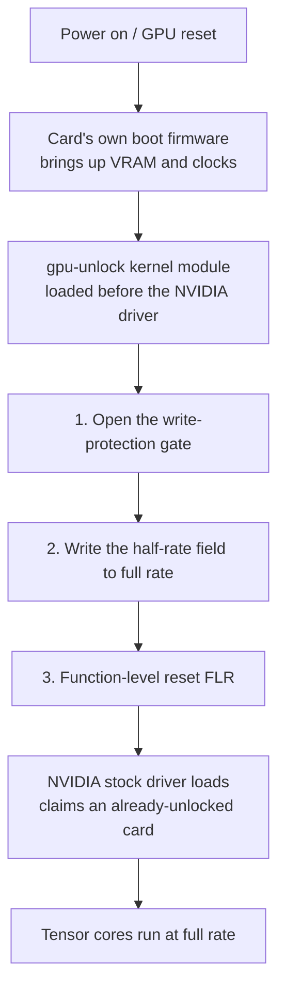

```opener
{
  "word": "½ → 1×",
  "headline": "Same GPU, same power draw, BF16 goes from 25 to 42 TFLOPS.",
  "sub": "My RTX 3060 laptop, dense matrix multiply measured before and after a gpu-unlock cold boot:",
  "readouts": [
    {"label": "BF16 locked", "value": "25 TFLOPS"},
    {"label": "BF16 unlocked", "value": "42 TFLOPS"},
    {"label": "Power", "value": "~105 W both"}
  ],
  "note": "RTX 3060 Laptop 6GB · kernel 7.0.0-38 · driver 595.99.02 · 4096³ dense GEMM · measured 2026-10-29"
}
```

> [!TIP]
> New to GPUs and only after the backstory and what it means? Start with the illustrated beginner edition, [Same Chip, Half the Speed](/en/posts/nvidia-tensor-half-speed-explained/); no registers needed.

*This post is for anyone with a consumer NVIDIA card who uses it for local training, fine-tuning or image generation, and for anyone curious why one piece of silicon gets sorted into tiers. You do not need to know GPU microarchitecture: I build the mental model first, then the details. The performance numbers come from one of my own machines, an RTX 3060 Laptop (6GB), measured on 2026-10-29. Numbers from the project README, the community and third parties carry their source and should be read as reference. The post is based on gpu-unlock upstream commit [`7eb51bc`](https://github.com/Zagitta/gpu-unlock/tree/7eb51bc) (2026-10-28), plus the 3060 Laptop device ID I added locally; checked on 2026-10-29. The details of the exploit the unlock relies on are out of scope; I link the author's write-up for those.*

---

## The conclusion first (version and scope)

- **What it frees**: On consumer (GeForce) cards, NVIDIA caps **FP16 / BF16 / TF32 tensor math with FP32 accumulation** at half rate, which separates them from professional cards built on the same silicon. [gpu-unlock](https://github.com/Zagitta/gpu-unlock), an open-source kernel module, lifts that cap before the GPU driver loads, with no patched driver and no VBIOS flash. The repository was created on 2026-10-18, reached [Hacker News](https://news.ycombinator.com/item?id=50219700) on 10-24 with 349 points, and had about 12,000 stars by 10-29.
- **Measured on my machine**: dense matrix multiply got 55% to 68% faster (about 1.6x), and a small BF16 training run got 40% faster. **The FP32 and INT8 controls did not change**; they were never capped.
- **Scope**: RTX 30 (Ampere) is stable; RTX 20 (Turing) and RTX 40 (Ada) are experimental. Turing has no BF16 or TF32 hardware, so on RTX 20 only FP16 is unlocked. **RTX 50 (Blackwell) cannot be unlocked**; I explain why below. Linux only.
- **This is not overclocking**: it does not touch clocks, power limits or voltage. If the unlock fails, the stock driver still loads, and the worst case is no unlock. Laptops carry extra costs, covered in the last section.

---

## Which part of the hardware is capped: the tensor core's issue cadence

First, a correction to a common instinct: **what is held back is not the tensor core itself, but how often it is fed an instruction.**

A GPU's compute is nested. A card has tens to over a hundred **SMs (streaming multiprocessors)**: my 3060 Laptop has 30 and a 4090 has 128. Each SM holds two kinds of compute units: **CUDA cores** for game shading and ordinary floating point, and **tensor cores** for matrix multiply. Each SM is also split into 4 partitions, and each partition has its own **scheduler and dispatch unit**, which sends at most one instruction per clock to the execution units.

What NVIDIA changed on consumer cards is the dispatch cadence for **a few specific classes of instructions**: one is issued **every two clocks** instead of every clock. The tensor core can physically run at full rate, as it does when the same silicon ships in a professional card. On a consumer card, though, it sits idle half the time waiting for work, so effective throughput halves.

The cadence is set by a config register in the SM. It is split into small fields, one per class of operation: ordinary float, the FP16/BF16 matrix path, the TF32 matrix path and integer matrix math each have one. **Going by the author's documentation and my own control runs, only the FP16/BF16 and TF32 matrix fields are set to half on consumer cards**: my INT8 and FP32 controls did not move at all after the unlock. Keep that in mind; it accounts for everything below about what speeds up and what does not.

> [!NOTE]
> So the speedup does not come from higher clocks or more power. The unlock fills dispatch slots that were sitting empty. How much faster you actually get depends on whether the card has power headroom, and the next section's laptop numbers show a card held back by its power limit.

---

## Measured on my machine: same power, lower clock

On my own RTX 3060 Laptop (6GB, GA106M), I ran dense matrix multiply before and after the unlock, using cuBLAS with FP32 accumulation and taking the median. The laptop stayed on AC power the whole time, and power sat at the limit of about 105 W in both runs.

```chart
{
  "type": "bars",
  "fmt": {"suf": " TFLOPS", "digits": 1},
  "rows": [
    {"label": "BF16 · locked", "value": 25.4, "color": "gray"},
    {"label": "BF16 · unlocked", "value": 41.9, "color": "seal"},
    {"label": "FP16 · locked", "value": 25.5, "color": "gray"},
    {"label": "FP16 · unlocked", "value": 41.7, "color": "seal"},
    {"label": "TF32 · locked", "value": 12.6, "color": "gray"},
    {"label": "TF32 · unlocked", "value": 20.4, "color": "seal"}
  ],
  "legend": [{"color": "seal", "label": "unlocked"}, {"color": "gray", "label": "locked"}],
  "caption": "RTX 3060 Laptop 6GB, 4096³ dense matrix multiply, throughput before and after (higher is better). The 8192³ results are in the appendix."
}
```

Why only about 1.6x and not a doubling? Because of power. In both matrix-multiply runs this laptop sat at its power limit of about 105 W. After the unlock, the tensor cores do close to twice the work per clock, and the same power can no longer hold the old clock: **the SM clock dropped from about 1760 MHz to about 1470 MHz, about 17% lower**.

Multiply the two together: the theoretical doubling times 0.83 is about 1.67x, almost exactly the measured 1.65x. A desktop card with more power headroom gets closer to a doubling. The project README reports +87% for the RTX 3060 12GB (desktop); that figure is reference, not mine.

On a real training run, I trained a 6-layer Transformer in BF16 mixed precision:

```chart
{
  "type": "bars",
  "fmt": {"suf": " token/s", "digits": 0},
  "rows": [
    {"label": "locked", "value": 31457, "color": "gray"},
    {"label": "unlocked", "value": 44116, "color": "seal"}
  ],
  "caption": "BF16 mixed-precision training of a 6-layer Transformer (d=1024, seq=512, batch=16), tokens per second, +40%. Power during training rose from 97.9 W to 104.7 W: the unlocked card was kept busier."
}
```

The speed changed and the result did not. The final loss was 1.276369 before the unlock and 1.276358 after, a difference of 0.00001. To judge how big that is, I ran the same script three times in a row with the card unlocked, and the loss moved between 1.276363 and 1.276367. The before/after difference is slightly larger than that, but of the same order.

---

## Only these operation classes speed up

Put the gains for five classes of operations on the same machine side by side, and the pattern is plain to see:

```chart
{
  "type": "bars",
  "fmt": {"suf": "%", "digits": 0},
  "rows": [
    {"label": "BF16 matrix", "value": 65, "color": "seal"},
    {"label": "FP16 matrix", "value": 64, "color": "seal"},
    {"label": "TF32 matrix", "value": 63, "color": "seal"},
    {"label": "INT8 matrix (control)", "value": 0, "color": "gray"},
    {"label": "FP32 plain float (control)", "value": 0, "color": "gray"}
  ],
  "legend": [{"color": "seal", "label": "was capped"}, {"color": "gray", "label": "never capped"}],
  "caption": "4096³ dense matrix multiply, gain after the unlock. Only the three capped classes, FP16, BF16 and TF32, speed up."
}
```

There is one more piece of evidence. Before the unlock, my card's INT8 matrix multiply ran at about 2.9x the BF16 rate; after, about 1.8x (both at 4096³). For comparison, the data-center Ampere A100, which has no such cap, is rated in its [official specs](https://www.nvidia.com/en-us/data-center/a100/) at 312 TFLOPS BF16 and 624 TOPS INT8, exactly 2x. The ratio falling from 2.9 back to around 2 means the BF16 side really had been held to half.

Use this list to decide whether it is worth the trouble:

- **Gets faster**:
  - Measured on my machine: BF16, FP16 and TF32 matrix multiply, and PyTorch BF16 training.
  - Per the project README (reference figures): diffusion image generation such as SDXL and Flux, FlashAttention, and the **prefill** stage of LLMs (reading the prompt). All of these run the matrix classes that were freed.
- **Does not get faster**:
  - Measured on my machine: ordinary FP32 math and INT8 matrix multiply.
  - Per the project README: no change for game frame rates (FP32 graphics pipeline) or LLM **token generation** (bound by memory bandwidth, not compute); quantized GGUF in llama.cpp gains 0–15%, mostly at long context.

> [!TIP]
> If you want more game FPS, this project won't help; it is not overclocking. What it frees is **half-precision compute for local AI**.

---

## How the cap is opened at boot

As noted above, that speed field sits behind a **write-protection gate**: once the system is running, writes to it from the driver side are not accepted. So the unlock has to happen in the window when the card's own boot firmware is still running and the regular driver has not yet taken the card.

gpu-unlock is a Linux kernel module that loads **before the NVIDIA driver**. In that boot window it does three things, then hands the card back to the stock driver:



It opens the gate through a **known flaw** in the card's boot firmware, the same one behind the earlier NVIDIA CMP mining-card unlocks. Because all of this happens before the driver loads, there is **no patched driver, no VBIOS flash, and nothing to redo after a driver update**. How the flaw is exploited is out of scope here; for the deep dive, see the author's [*How Ampere was unlocked*](https://github.com/Zagitta/gpu-unlock/blob/7eb51bc/docs/How%20Ampere%20was%20unlocked.md).

This also brings one hard constraint: **it must be a cold boot**. Once the stock driver has touched the card, the window is closed: the module refuses to act and tells you to power off first. Laptops need extra care here. The discrete GPU powers down when idle, and a power-down resets the unlock. That pitfall is covered in the last section.

---

## Why RTX 50 cannot be unlocked

First, a correction to a common misreading: **NVIDIA did not remove the cap on the new cards**; the unlocking method just can no longer get in. The cap itself is still there. Two third parties have measured it on the RTX 5090:

- [ai.rs](https://ai.rs/ai-developer/rtx-5090-tensor-core-unlock-blackwell) (2026-10-25), using its own read-only issue-rate probe, measured 224.3 TFLOPS with FP32 accumulation against 441.4 TFLOPS with FP16 accumulation, so the former runs at about 51% of the latter. The article says this matches the 209.5 vs 419 split in NVIDIA's whitepaper.
- [phiraml/gpu-unlock-blackwell](https://github.com/phiraml/gpu-unlock-blackwell), using a different harness, measured a ratio of about 0.68.

The two numbers differ, but both show the cap still exists on consumer Blackwell. Neither number is mine.

So why can't it be unlocked? The method depends on a very specific chain. The flaw sits in a signed boot firmware on the card's security processor, and it could be studied only because NVIDIA made a debug build of that firmware public. Turing, Ampere and Ada share this boot chain, which is why one method covers all three generations.

According to the two research sources above and the notes attached to an unmerged upstream PR ([#116](https://github.com/Zagitta/gpu-unlock/pull/116)), Blackwell is different:

- Boot goes through a new chain (FSP/FMC), and the firmware exploited on the older cards is not part of it.
- The new bootloader is about three times larger, and there is an extra, separately signed firmware-management component.
- When the host writes the speed-select registers directly, the writes are silently dropped.
- No debug firmware for the new cards can be found in public, so there is nowhere to start looking for a flaw.

The author's [FAQ](https://github.com/Zagitta/gpu-unlock/tree/7eb51bc#faq) says plainly that Blackwell is "not supported and unlikely to happen".

> [!NOTE]
> In one line: the older cards can be unlocked because of two historical conditions. Three generations share one boot chain, and a public debug firmware made it possible to study. The new cards switched to a different boot architecture and closed this path in advance. **The lock is still there; the key is gone.**

---

## This kind of bypass is not new

NVIDIA has been tiering the same generation of silicon through firmware and drivers for years, and the community keeps finding ways around it. gpu-unlock is just the latest example:

| What was locked | What happened |
| --- | --- |
| vGPU virtualization on consumer cards (a feature kept for pro cards) | [`vgpu_unlock`](https://github.com/DualCoder/vgpu_unlock) lets consumer cards split into vGPUs |
| **LHR mining throttle** (closest to this one: a direct compute lock) | In 2021 one of NVIDIA's own test drivers (470.05) [accidentally lifted the RTX 3060 throttle](https://hothardware.com/news/nvidia-confirms-geforce-rtx-3060-eth-mining-limiter-defeated-by-rogue-beta-driver); later, third-party miners [bypassed it fully](https://www.pcgamer.com/au/nvidia-lhr-lite-hash-rate-mining-gpu-limiter-full-bypass-unlock); finally NVIDIA [removed the throttle itself](https://www.guru3d.com/news-story/in-the-latest-drivernvidia-removes-the-hashrate-limiter-for-rtx-30-series-lhr-gpus.html) in driver 522.25 |
| CMP 170HX mining cards (VRAM capacity, compute and more locked in firmware) | [`cmpunlocker`](https://github.com/amoghmunikote/cmpunlocker) restored them ([Tom's Hardware coverage](https://www.tomshardware.com/pc-components/gpus/nvidia-crypto-mining-gpus-hacked-to-restore-locked-away-vram-in-order-to-feed-ai-boom-software-mod-unlocks-64gb-of-vram-on-usd250-cmp-170hx)). **gpu-unlock reuses its exploit** |

These patches have one thing in common: none of them turns a small card into a big one. Each restores an ability **the same silicon already had but was deliberately held back**. The vendor side follows a pattern too. Sometimes a fix is followed by the next flaw being found; sometimes the vendor gives up, as with LHR; and sometimes it closes the path in advance in a new architecture, as with Blackwell.

---

## Should you install it: costs and rollback

It does not touch clocks, power limits or voltage, so there is **none of overclocking's stability risk**. If the unlock fails, the stock driver still loads, and the worst case is no unlock. The project README says outputs are bit-identical before and after; I did not do a bit-level comparison, and only saw the training loss stay the same (see above).

It does carry some real costs, especially on a laptop:

- **Secure Boot**: mine is off. With it on, the kernel module's signature has to be trusted by the system (for example by enrolling a MOK), or the module will not load.
- **On a laptop the discrete GPU must stay powered** (driver parameter `NVreg_DynamicPowerManagement=0x00`). Otherwise an idle power-down resets the unlock. The cost is **shorter battery life and a hotter machine**.
- **I also added `NVreg_GpuInitOnProbe=1`**. I set it up front based on [issue #135](https://github.com/Zagitta/gpu-unlock/issues/135), where a Lenovo 3060 Laptop had its unlock overwritten during driver initialization without it. I have not tested what happens without it.
- **It does not add VRAM**. 6GB stays 6GB, so the size of model you can run is unchanged; the same work just runs faster.
- **My card is not on the official support list**. The README lists only the 3070 and 3080 Laptop GPUs. My RTX 3060 Laptop's device ID (`10de:2520`) was dropped in a refactor, so you have to add it back before it works. Upstream [PR #212](https://github.com/Zagitta/gpu-unlock/pull/212) does exactly that and was still unmerged as of 2026-10-29. The PR notes that this ID "has no test report yet"; this post is one.
- **Rollback is easy**:
  - For a single boot without the unlock: press `e` in the GRUB menu and delete the kernel parameter.
  - To turn it off for good: remove the kernel parameter and the modprobe config, uninstall the two packages, and rebuild the initramfs.

When it is worth installing: you **regularly use this consumer NVIDIA card for BF16 or FP16 training or fine-tuning, or for diffusion image generation**, and you can accept the costs above.

When to leave it alone: you mainly **game** on the card, or you only run quantized models in llama.cpp for token generation. It does not help in either case.

---

## How to measure it yourself

Don't trust numbers from any single source, mine included; running it yourself is the most reliable check. The essentials:

- **Measure the capped classes**: run FP16, BF16 and TF32 dense matrix multiply, plus FP32 and INT8 as controls. Only if the controls stay flat do you know you measured the unlock itself rather than some other drift. PyTorch's half-precision matrix multiply already accumulates in FP32; I also turned off `allow_fp16/bf16_reduced_precision_reduction` so the reductions in split computations do not lose precision.
- **Check that the unlock took**: `journalctl -k -b | grep gpu_unlock` shows `unlocked`, throughput rises for the three capped classes, and the controls stay flat. What the clock does depends on power headroom: a card at its power limit (like my laptop) clocks down, while a desktop card with headroom may not. So don't use the clock on its own as the test.
- **On a laptop, stay on AC** and let the machine idle for a few minutes after boot before measuring; otherwise thermal throttling muddies the numbers.

The benchmark script I used (PyTorch, about 4 minutes, free) is in the appendix.

---

**One line to close**: gpu-unlock is not overclocking, it adds no frames, and it does not turn your card into a different card. It does exactly one thing: NVIDIA pressed the tensor cores down to half speed on consumer cards to protect its expensive professional lineup, and gpu-unlock **puts that half back**. For anyone doing local AI on a consumer card, that one thing is a real speedup: about 1.6x on my power-limited laptop, and closer to a doubling on a card with more power to spare.

<details>
<summary>Appendix: full data and the benchmark script</summary>

Machine: RTX 3060 Laptop 6GB, kernel 7.0.0-38, driver 595.99.02, 2026-10-29, on AC at about 105 W.

| Metric (4096³ / 8192³) | Locked | Unlocked |
| --- | --- | --- |
| FP16 | 25.5 / 24.9 TFLOPS | 41.7 / 38.6 |
| BF16 | 25.4 / 25.2 | 41.9 / 39.4 |
| TF32 | 12.6 / 12.2 | 20.4 / 20.5 |
| FP32 (control) | 6.5 / 7.9 | 6.5 / 8.0 |
| INT8 (control) | 74.5 / 74.5 TOPS | 74.5 / 75.8 |
| BF16 training | 31,457 token/s | 44,116 token/s |

- **Clocks**: BF16 4096³ dropped from about 1760 MHz to about 1470 MHz, and 8192³ from about 1650 MHz to about 1330 MHz, with power at about 105 W on both sides.
- **Run-to-run spread**: three back-to-back training runs with the card unlocked gave 45,650–46,033 token/s, so the +40% in the text is on the conservative side.

```python
# bench_tensor.py: gpu-unlock before/after benchmark (dense GEMM + small BF16 training), logs SM clock and power
# usage: python bench_tensor.py --tag before|after --out bench-<tag>.json
import argparse, json, platform, statistics, subprocess, threading, time
import torch

def smi_sampler(stop, rows):
    q = "clocks.sm,power.draw,temperature.gpu"
    while not stop.is_set():
        out = subprocess.run(["nvidia-smi", f"--query-gpu={q}", "--format=csv,noheader,nounits"],
                             capture_output=True, text=True).stdout.strip()
        try:
            sm, pw, t = [float(x) for x in out.split(",")]
            rows.append((sm, pw, t))
        except ValueError:
            pass
        stop.wait(0.5)

def timed(fn, iters):
    torch.cuda.synchronize()
    s = torch.cuda.Event(enable_timing=True); e = torch.cuda.Event(enable_timing=True)
    s.record()
    for _ in range(iters):
        fn()
    e.record(); torch.cuda.synchronize()
    return s.elapsed_time(e) / 1000 / iters

def gemm_case(name, n, warm_s, samples, iters):
    torch.backends.cuda.matmul.allow_fp16_reduced_precision_reduction = False
    torch.backends.cuda.matmul.allow_bf16_reduced_precision_reduction = False
    if name == "int8":
        a = torch.randint(-64, 64, (n, n), dtype=torch.int8, device="cuda")
        b = torch.randint(-64, 64, (n, n), dtype=torch.int8, device="cuda").t().contiguous().t()
        fn = lambda: torch._int_mm(a, b)
    else:
        dt = {"fp16": torch.float16, "bf16": torch.bfloat16, "tf32": torch.float32, "fp32": torch.float32}[name]
        torch.backends.cuda.matmul.allow_tf32 = name == "tf32"
        a = torch.randn(n, n, dtype=dt, device="cuda"); b = torch.randn(n, n, dtype=dt, device="cuda")
        fn = lambda: a @ b
    end = time.time() + warm_s
    while time.time() < end:
        fn()
    torch.cuda.synchronize()
    stop, rows = threading.Event(), []
    th = threading.Thread(target=smi_sampler, args=(stop, rows)); th.start()
    secs = [timed(fn, iters) for _ in range(samples)]
    stop.set(); th.join()
    med = statistics.median(secs)
    tflops = 2 * n ** 3 / med / 1e12
    return {"case": name, "n": n, "tflops": round(tflops, 2), "ms": round(med * 1000, 3),
            "sm_mhz": round(statistics.median(r[0] for r in rows)) if rows else None,
            "power_w": round(statistics.median(r[1] for r in rows), 1) if rows else None,
            "temp_c": round(statistics.median(r[2] for r in rows)) if rows else None}

def train_case(warm_steps, steps):
    torch.manual_seed(0)
    d, layers, seq, batch = 1024, 6, 512, 16
    layer = torch.nn.TransformerEncoderLayer(d, 16, 4 * d, batch_first=True, dropout=0.0, norm_first=True)
    model = torch.nn.TransformerEncoder(layer, layers, enable_nested_tensor=False).cuda()
    head = torch.nn.Linear(d, d).cuda()
    opt = torch.optim.AdamW(list(model.parameters()) + list(head.parameters()), lr=1e-4)
    x = torch.randn(batch, seq, d, device="cuda"); y = torch.randn(batch, seq, d, device="cuda")
    def step():
        with torch.autocast("cuda", dtype=torch.bfloat16):
            loss = torch.nn.functional.mse_loss(head(model(x)), y)
        loss.backward(); opt.step(); opt.zero_grad(set_to_none=True)
        return loss
    for _ in range(warm_steps):
        step()
    torch.cuda.synchronize()
    stop, rows = threading.Event(), []
    th = threading.Thread(target=smi_sampler, args=(stop, rows)); th.start()
    t0 = time.time()
    for _ in range(steps):
        loss = step()
    torch.cuda.synchronize(); dt = time.time() - t0
    stop.set(); th.join()
    return {"case": "train_bf16_transformer", "layers": layers, "d_model": d, "seq": seq, "batch": batch,
            "step_ms": round(dt / steps * 1000, 1), "tokens_per_s": round(batch * seq * steps / dt),
            "final_loss": round(loss.item(), 6),
            "sm_mhz": round(statistics.median(r[0] for r in rows)) if rows else None,
            "power_w": round(statistics.median(r[1] for r in rows), 1) if rows else None}

def env_info():
    def sh(cmd):
        return subprocess.run(cmd, shell=True, capture_output=True, text=True).stdout.strip()
    return {"gpu": torch.cuda.get_device_name(0), "torch": torch.__version__, "cuda": torch.version.cuda,
            "driver": sh("nvidia-smi --query-gpu=driver_version --format=csv,noheader"),
            "kernel": platform.release(), "cmdline_has_gpu_unlock": "gpu_unlock" in open("/proc/cmdline").read(),
            "gpu_unlock_loaded": bool(sh("lsmod | grep -w gpu_unlock")),
            "ac_online": sh("cat /sys/class/power_supply/AC*/online 2>/dev/null"),
            "time": time.strftime("%Y-%m-%d %H:%M:%S %z")}

if __name__ == "__main__":
    ap = argparse.ArgumentParser()
    ap.add_argument("--tag", required=True); ap.add_argument("--out", required=True)
    ap.add_argument("--warm", type=float, default=8); ap.add_argument("--samples", type=int, default=5)
    a = ap.parse_args()
    res = {"tag": a.tag, "env": env_info(), "gemm": [], "train": None}
    for n in (4096, 8192):
        for case in ("fp16", "bf16", "tf32", "fp32", "int8"):
            r = gemm_case(case, n, a.warm, a.samples, iters=10 if n == 4096 else 4)
            print(json.dumps(r, ensure_ascii=False), flush=True)
            res["gemm"].append(r)
    res["train"] = train_case(warm_steps=10, steps=30)
    print(json.dumps(res["train"], ensure_ascii=False), flush=True)
    json.dump(res, open(a.out, "w"), ensure_ascii=False, indent=2)
```

</details>
