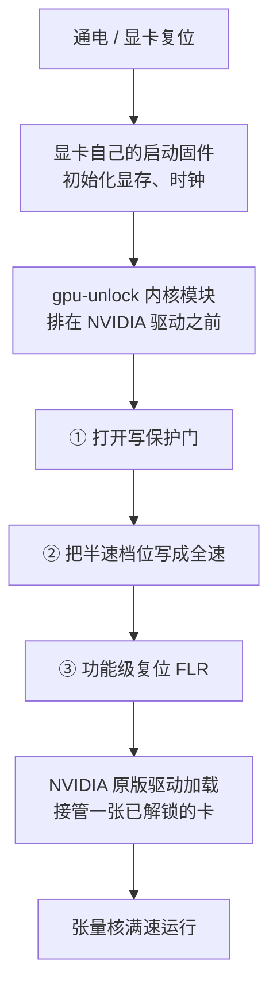

```opener
{
  "word": "½ → 1×",
  "headline": "同一张显卡、同样的功耗，BF16 从 25 涨到 42 TFLOPS。",
  "sub": "我的 RTX 3060 笔记本，装 gpu-unlock 冷启动前后，稠密矩阵乘法实测：",
  "readouts": [
    {"label": "解锁前 BF16", "value": "25 TFLOPS"},
    {"label": "解锁后 BF16", "value": "42 TFLOPS"},
    {"label": "功耗", "value": "都是 ~105 W"}
  ],
  "note": "RTX 3060 Laptop 6GB · 内核 7.0.0-38 · 驱动 595.99.02 · 4096³ 稠密 GEMM · 2026-10-29 本机实测"
}
```

*这篇写给手上有消费级 N 卡、用它做本地训练、微调或出图的人，也写给好奇「同一块芯片凭什么分三六九等」的人。不需要你懂显卡微架构，我先搭心智模型再讲细节。性能数字来自我自己的一台 RTX 3060 Laptop（6GB），2026-10-29 实测；项目 README、社区和第三方的数字会标明出处，当参考看。本文基于 gpu-unlock 上游提交 [`7eb51bc`](https://github.com/Zagitta/gpu-unlock/tree/7eb51bc)（2026-10-28），外加我本地补上的 3060 Laptop 型号；检查日期 2026-10-29。解锁所依赖的漏洞细节不在这篇展开，想看的我会给原文链接。*

---

## 先说结论（版本与范围）

- **它放开的是什么**：在消费卡（GeForce）上，NVIDIA 把用 FP32 累加的 **FP16 / BF16 / TF32 张量运算**限成了半速，以此和同一块芯片做成的专业卡拉开差距。[gpu-unlock](https://github.com/Zagitta/gpu-unlock) 是一个开源内核模块，在显卡驱动加载前解开这个限制，不改驱动、不刷 VBIOS。项目 2026-10-18 建仓，10-24 上了 [Hacker News](https://news.ycombinator.com/item?id=50219700)（349 分），截至 10-29 约 1.2 万星。
- **本机实测**：稠密矩阵乘法快了 55% 到 68%（约 1.6 倍），BF16 小模型训练快了 40%。**FP32 和 INT8 两个对照组不变**，它们本来就没被锁。
- **范围**：RTX 30（Ampere）稳定支持；RTX 20（Turing）和 RTX 40（Ada）是实验性支持。Turing 没有 BF16 和 TF32 硬件，所以 RTX 20 只解开 FP16。**RTX 50（Blackwell）解不了**，后面讲原因。只支持 Linux。
- **这不是超频**：它不碰频率墙、功耗墙和电压；解锁失败时原版驱动照常加载，最坏也就是没解开。笔记本有额外代价，见最后一节。

---

## 被锁的是哪一部分：张量核的「发射节奏」

先纠正一个直觉：**被按住的不是张量核本身，而是「多久给它喂一条指令」。**

显卡的计算单元是层层嵌套的。一张卡里有几十到一百多个 **SM（流式多处理器）**，我这张 3060 Laptop 有 30 个，4090 有 128 个。每个 SM 里有两类计算单元：跑游戏着色和普通浮点的 **CUDA 核**，和专做矩阵乘法的 **张量核**。每个 SM 还分成 4 个分区，每个分区有自己的**调度和发射单元**，每个时钟周期最多把一条指令送给执行单元。

消费卡上被动了手脚的，是发射单元对**特定几类指令**的节奏：改成**每 2 个周期才发一条**。张量核物理上完全能跑满速，同一块芯片做成专业卡时就是满速。但在消费卡上，它有一半时间在空等指令，实际吞吐因此减半。

管这个节奏的是 SM 里的一个配置寄存器。它分成几个小字段，每个字段管一类运算的发射速度：普通浮点、FP16/BF16 矩阵、TF32 矩阵、整数矩阵各有一格。**按作者文档和我的对照数据推断，消费卡出厂时被设成半速的只有 FP16/BF16 矩阵和 TF32 矩阵这几格**：我的 INT8 和 FP32 对照组在解锁前后一点没动。记住这一点，下面「什么变快、什么不变」都能对上。

> [!NOTE]
> 所以解锁带来的提速，不是靠拉高频率、也不是靠多吃电换来的：它把空着的发射机会填满了。至于最后能快多少，要看显卡还有没有功耗余量。下一节的笔记本数据，就是被功耗墙卡住的例子。

---

## 本机实测：同功耗，频率反而降了

我在自己的 RTX 3060 Laptop（6GB，GA106M）上，解锁前后各跑了一遍稠密矩阵乘法：用 cuBLAS，FP32 累加，取中位数。全程插电，功耗都顶在约 105 W。

```chart
{
  "type": "bars",
  "fmt": {"suf": " TFLOPS", "digits": 1},
  "rows": [
    {"label": "BF16 · 解锁前", "value": 25.4, "color": "gray"},
    {"label": "BF16 · 解锁后", "value": 41.9, "color": "seal"},
    {"label": "FP16 · 解锁前", "value": 25.5, "color": "gray"},
    {"label": "FP16 · 解锁后", "value": 41.7, "color": "seal"},
    {"label": "TF32 · 解锁前", "value": 12.6, "color": "gray"},
    {"label": "TF32 · 解锁后", "value": 20.4, "color": "seal"}
  ],
  "legend": [{"color": "seal", "label": "解锁后"}, {"color": "gray", "label": "解锁前"}],
  "caption": "RTX 3060 Laptop 6GB，4096³ 稠密矩阵乘法，解锁前后的吞吐（越高越好）。8192³ 的结果见附录。"
}
```

为什么只有约 1.6 倍，而不是翻倍？关键在功耗。这台笔记本两次跑矩阵乘法时，功耗都顶在约 105 W 的上限上。解锁后，张量核每个时钟周期干的活接近原来的两倍，同样的电撑不住原来的频率了：**SM 频率从约 1760 MHz 降到约 1470 MHz，降了约 17%**。

把这两件事乘起来，理论上的「翻倍」乘以 0.83，约等于 1.67 倍，和实测的 1.65 倍几乎一样。功耗余量更大的台式卡能更接近翻倍。项目 README 给 RTX 3060 12GB（台式）报的是 +87%，这是参考数字，不是我测的。

落到真实训练上，我跑了一个 6 层 Transformer 的 BF16 混合精度训练：

```chart
{
  "type": "bars",
  "fmt": {"suf": " token/s", "digits": 0},
  "rows": [
    {"label": "解锁前", "value": 31457, "color": "gray"},
    {"label": "解锁后", "value": 44116, "color": "seal"}
  ],
  "caption": "BF16 混合精度训练一个 6 层 Transformer（d=1024, seq=512, batch=16），每秒处理的 token 数，+40%。训练时的功耗从 97.9 W 升到 104.7 W，解锁后显卡吃得更满。"
}
```

速度变了，结果没变。最终 loss 解锁前是 1.276369，解锁后是 1.276358，相差 0.00001。为了判断这个差有多大，我在解锁状态下把同一个脚本连跑了三次，loss 在 1.276363 和 1.276367 之间浮动。前后的差比这个浮动略大，但量级相同。

---

## 只有这几类运算变快

把同一台机器上五类运算的提升幅度放在一起，规律一眼就能看出来：

```chart
{
  "type": "bars",
  "fmt": {"suf": "%", "digits": 0},
  "rows": [
    {"label": "BF16 矩阵", "value": 65, "color": "seal"},
    {"label": "FP16 矩阵", "value": 64, "color": "seal"},
    {"label": "TF32 矩阵", "value": 63, "color": "seal"},
    {"label": "INT8 矩阵（对照）", "value": 0, "color": "gray"},
    {"label": "FP32 普通浮点（对照）", "value": 0, "color": "gray"}
  ],
  "legend": [{"color": "seal", "label": "被解开了"}, {"color": "gray", "label": "本来就没锁"}],
  "caption": "4096³ 稠密矩阵乘法，解锁前后的提升幅度。只有被锁的 FP16、BF16、TF32 三类变快。"
}
```

还有一个旁证。解锁前，我这张卡的 INT8 矩阵乘法是 BF16 的约 2.9 倍；解锁后降到约 1.8 倍（都是 4096³）。作为参照，没有这个限制的数据中心 Ampere 卡 A100，[官方规格](https://www.nvidia.com/en-us/data-center/a100/)是 BF16 312 TFLOPS、INT8 624 TOPS，正好 2 倍。比值从 2.9 回落到 2 附近，说明之前 BF16 这一侧确实被压了一半。

对照下面的清单，就知道该不该为它折腾：

- **会变快**：
  - 本机实测：BF16、FP16、TF32 矩阵乘法，PyTorch 的 BF16 训练。
  - 据项目 README（参考数字）：SDXL、Flux 这类扩散模型出图，FlashAttention，大模型的 **prefill**（读提示词那段）。它们都在跑被解开的那几类矩阵运算。
- **不会变快**：
  - 本机实测：FP32 普通浮点、INT8 矩阵乘法。
  - 据项目 README：游戏帧数（走 FP32 图形管线）、大模型**出字速度**（卡在显存带宽，不是算力）没有变化；llama.cpp 跑的量化 GGUF 是 0–15%，主要出现在长上下文。

> [!TIP]
> 想提游戏帧数的话，这个项目帮不上忙，它不是超频。它松绑的是**本地 AI 的半精度计算**。

---

## 它怎么在开机时把锁打开

前面说过，那个速度档位被一道**写保护门**挡着：系统正常跑起来以后，从驱动这一侧去写它，写不进去。所以只能趁显卡还没被普通驱动接管、它自己的启动固件还在跑的那个窗口动手。

gpu-unlock 是一个 Linux 内核模块，排在 **NVIDIA 驱动之前**加载。它在开机窗口里做三件事，然后把卡交还给原版驱动：



开门靠的是显卡启动固件里一个**已知漏洞**，和早前解锁 NVIDIA 矿卡 CMP 用的是同一个。因为整个动作发生在驱动加载之前，所以**不用改驱动、不刷 VBIOS，驱动更新了也不用重做**。漏洞具体怎么利用，这篇不展开，想深入的可以看作者原文[《How Ampere was unlocked》](https://github.com/Zagitta/gpu-unlock/blob/7eb51bc/docs/How%20Ampere%20was%20unlocked.md)。

这也带来一个硬约束：**必须冷启动**。只要原版驱动已经碰过这张卡，窗口就关上了，模块会拒绝动作，并提示先断电。笔记本尤其要注意：独显空闲时会断电，一断电解锁就被复位。这是最后一节要讲的坑。

---

## 为什么 RTX 50 解不了

先纠正一个容易误会的点：**不是 NVIDIA 在新卡上取消了这个限制**，而是解锁的办法进不去了。限制本身还在，有两家第三方实测过 RTX 5090：

- [ai.rs](https://ai.rs/ai-developer/rtx-5090-tensor-core-unlock-blackwell)（2026-10-25）用自己写的只读发射率探针测到，FP32 累加的速率是 224.3 TFLOPS，FP16 累加是 441.4 TFLOPS，前者约为后者的 51%。文中说这和 NVIDIA 白皮书给的 209.5 对 419 吻合。
- [phiraml/gpu-unlock-blackwell](https://github.com/phiraml/gpu-unlock-blackwell) 用另一套测法，测到的比值约为 0.68。

两家的数字不一样，但都说明消费版 Blackwell 上仍有这个限制。这两个数都不是我测的。

那为什么解不开？这套办法依赖一条很特定的链。漏洞在显卡安全处理器上一段签名的启动固件里，而它之所以能被研究出来，是因为 NVIDIA 公开过这段固件的调试版本。Turing、Ampere、Ada 这三代共用这条启动链，所以一套办法能通吃三代。

按上面两个研究来源，以及上游一个未合并 PR（[#116](https://github.com/Zagitta/gpu-unlock/pull/116)）附带的说明，Blackwell 的情况是：

- 开机流程换成了新的启动链（FSP/FMC），老卡被利用的那段固件不在其中。
- 新的引导程序大了约三倍，还多了一个单独签名的固件管理组件。
- 从主机直接写那几个档位寄存器，写入会被悄悄丢掉。
- 公开渠道找不到新卡的调试固件，也就没有反推漏洞的起点。

项目作者在 [FAQ](https://github.com/Zagitta/gpu-unlock/tree/7eb51bc#faq) 里直接写了，Blackwell「不支持，也不太可能支持」。

> [!NOTE]
> 一句话：老卡能解，是赶上了两个历史条件，一是三代共用一条启动链，二是有一份公开的调试固件可以研究。新卡换了启动架构，把这条路提前堵死了。**锁还在，钥匙没了。**

---

## 这类「绕过人为限制」不是头一回

NVIDIA 用固件和驱动给同一代芯片分档，社区再想办法绕过去，这样的拉锯已经持续好几年了。gpu-unlock 只是最新一例：

| 锁的是什么 | 后来怎样 |
| --- | --- |
| 消费卡的 vGPU 虚拟化（留给专业卡的功能） | [`vgpu_unlock`](https://github.com/DualCoder/vgpu_unlock) 让消费卡也能切分 vGPU |
| **LHR 挖矿限速**（和这次最像，直接锁算力） | 2021 年 NVIDIA 自己的一版测试驱动（470.05）[意外解除了 RTX 3060 的限速](https://hothardware.com/news/nvidia-confirms-geforce-rtx-3060-eth-mining-limiter-defeated-by-rogue-beta-driver)；之后第三方挖矿软件[完全绕过了它](https://www.pcgamer.com/au/nvidia-lhr-lite-hash-rate-mining-gpu-limiter-full-bypass-unlock)；最后 NVIDIA 在 522.25 驱动里[自己把限速删了](https://www.guru3d.com/news-story/in-the-latest-drivernvidia-removes-the-hashrate-limiter-for-rtx-30-series-lhr-gpus.html) |
| 矿卡 CMP 170HX（固件里锁住了显存容量和算力等） | [`cmpunlocker`](https://github.com/amoghmunikote/cmpunlocker) 把这些放了出来（[Tom's Hardware 报道](https://www.tomshardware.com/pc-components/gpus/nvidia-crypto-mining-gpus-hacked-to-restore-locked-away-vram-in-order-to-feed-ai-boom-software-mod-unlocks-64gb-of-vram-on-usd250-cmp-170hx)）。**gpu-unlock 复用的就是它那套漏洞** |

这些补丁有个共同点：它们从来不是「把小卡变成大卡」，而是把**同一块芯片本来就有、被人为按住的能力**按回去。厂商这边也有规律可循：有时修了一个漏洞，又被找到下一个；有时干脆放弃，比如 LHR；也有时在新架构上提前把路堵死，比如 Blackwell。

---

## 要不要装：代价和回退

它不碰频率墙、功耗墙和电压，所以**没有超频那种稳定性风险**。解锁失败时，原版驱动照常加载，最坏也就是没解开。项目 README 称解锁前后的输出逐位相同；我没做逐位比对，只看到训练 loss 前后一致（见上文）。

但它有几个实打实的代价，笔记本尤其明显：

- **Secure Boot**：我这台是关着的。开着的话，要确保这个内核模块的签名被系统信任（比如登记 MOK），否则模块加载不了。
- **笔记本的独显要一直通电**（驱动参数 `NVreg_DynamicPowerManagement=0x00`）。不然独显空闲断电后，解锁会被复位。代价是**电池续航变差，机器也更热**。
- **我还加了 `NVreg_GpuInitOnProbe=1`**。这是照 [issue #135](https://github.com/Zagitta/gpu-unlock/issues/135) 预先加的（那台是联想的 3060 Laptop，不加时解锁会被驱动初始化盖掉）。我没测过不加会怎样。
- **显存不会变多**。6GB 还是 6GB，能跑多大的模型没变，只是同样的活跑得更快。
- **我这张卡不在官方支持列表里**。README 列出的笔记本型号只有 3070 和 3080 Laptop。我这张 RTX 3060 Laptop（`10de:2520`）的型号在一次重构里被漏掉了，要先自己补回去才能用。上游 [PR #212](https://github.com/Zagitta/gpu-unlock/pull/212) 做的就是这件事，截至 2026-10-29 还没合并。PR 里写着这个型号「还没有测试报告」，本文算是一份。
- **回退很简单**：
  - 只想某一次开机不解锁：在 GRUB 菜单按 `e`，删掉那行内核参数。
  - 想彻底关掉：删掉内核参数和那个 modprobe 配置，卸载两个包，再重建 initramfs。

什么时候值得装：你**经常用这张消费级 N 卡做 BF16 或 FP16 的训练、微调，或者用扩散模型出图**，而且能接受上面这些代价。

什么时候别碰：你主要拿它**打游戏**，或者只用 llama.cpp 跑量化模型出字。这两种场景它都帮不上忙。

---

## 怎么自己量

别信任何单一来源的数字，包括我的，自己跑一遍最可靠。要点如下：

- **测被锁的那几类**：跑 FP16、BF16、TF32 的稠密矩阵乘法，同时带上 FP32 和 INT8 作对照。对照组不变，才能说明你测到的是解锁本身，而不是别的波动。PyTorch 的半精度矩阵乘法默认就用 FP32 累加；我还额外关掉了 `allow_fp16/bf16_reduced_precision_reduction`，避免拆分计算后的归约降低精度。
- **判断解锁是否成功**：`journalctl -k -b | grep gpu_unlock` 能看到 `unlocked`，被锁的三类吞吐上涨，对照组不变。频率怎么变取决于功耗余量：顶着功耗墙的卡（比如我这台笔记本）会降频，有余量的台式卡未必。所以别把频率单独当判据。
- **笔记本要插着电**，开机后先静置几分钟再测，否则热节流会把数字搅乱。

我用的测速脚本（PyTorch，约 4 分钟，不花钱）放在附录里。

---

**一句话收尾**：gpu-unlock 不是超频，不提帧数，也不会把你的卡变成另一张卡。它做的只是一件事：NVIDIA 为了卖高价专业卡，在消费卡上把张量核按成了半速，它把这一半**按回原位**。对用消费卡做本地 AI 的人来说，这一件事意味着实打实的提速：在我这台被功耗墙卡住的笔记本上是约 1.6 倍，电够用的卡会更接近翻倍。

<details>
<summary>附录：本机完整数据与测速脚本</summary>

本机：RTX 3060 Laptop 6GB，内核 7.0.0-38，驱动 595.99.02，2026-10-29，插电约 105 W。

| 项（4096³ / 8192³） | 解锁前 | 解锁后 |
| --- | --- | --- |
| FP16 | 25.5 / 24.9 TFLOPS | 41.7 / 38.6 |
| BF16 | 25.4 / 25.2 | 41.9 / 39.4 |
| TF32 | 12.6 / 12.2 | 20.4 / 20.5 |
| FP32（对照） | 6.5 / 7.9 | 6.5 / 8.0 |
| INT8（对照） | 74.5 / 74.5 TOPS | 74.5 / 75.8 |
| BF16 训练 | 31,457 token/s | 44,116 token/s |

- **频率**：BF16 4096³ 从约 1760 MHz 降到约 1470 MHz，8192³ 从约 1650 MHz 降到约 1330 MHz，两边的功耗都约 105 W。
- **连跑抖动**：解锁状态下把训练连跑三次，吞吐在 45,650–46,033 token/s 之间，所以正文的 +40% 偏保守。

```python
# bench_tensor.py：gpu-unlock 解锁前后测速（稠密 GEMM + BF16 小模型训练），自动记录 SM 频率和功耗
# 用法：python bench_tensor.py --tag before|after --out bench-<tag>.json
import argparse, json, platform, statistics, subprocess, threading, time
import torch

def smi_sampler(stop, rows):
    q = "clocks.sm,power.draw,temperature.gpu"
    while not stop.is_set():
        out = subprocess.run(["nvidia-smi", f"--query-gpu={q}", "--format=csv,noheader,nounits"],
                             capture_output=True, text=True).stdout.strip()
        try:
            sm, pw, t = [float(x) for x in out.split(",")]
            rows.append((sm, pw, t))
        except ValueError:
            pass
        stop.wait(0.5)

def timed(fn, iters):
    torch.cuda.synchronize()
    s = torch.cuda.Event(enable_timing=True); e = torch.cuda.Event(enable_timing=True)
    s.record()
    for _ in range(iters):
        fn()
    e.record(); torch.cuda.synchronize()
    return s.elapsed_time(e) / 1000 / iters

def gemm_case(name, n, warm_s, samples, iters):
    torch.backends.cuda.matmul.allow_fp16_reduced_precision_reduction = False
    torch.backends.cuda.matmul.allow_bf16_reduced_precision_reduction = False
    if name == "int8":
        a = torch.randint(-64, 64, (n, n), dtype=torch.int8, device="cuda")
        b = torch.randint(-64, 64, (n, n), dtype=torch.int8, device="cuda").t().contiguous().t()
        fn = lambda: torch._int_mm(a, b)
    else:
        dt = {"fp16": torch.float16, "bf16": torch.bfloat16, "tf32": torch.float32, "fp32": torch.float32}[name]
        torch.backends.cuda.matmul.allow_tf32 = name == "tf32"
        a = torch.randn(n, n, dtype=dt, device="cuda"); b = torch.randn(n, n, dtype=dt, device="cuda")
        fn = lambda: a @ b
    end = time.time() + warm_s
    while time.time() < end:
        fn()
    torch.cuda.synchronize()
    stop, rows = threading.Event(), []
    th = threading.Thread(target=smi_sampler, args=(stop, rows)); th.start()
    secs = [timed(fn, iters) for _ in range(samples)]
    stop.set(); th.join()
    med = statistics.median(secs)
    tflops = 2 * n ** 3 / med / 1e12
    return {"case": name, "n": n, "tflops": round(tflops, 2), "ms": round(med * 1000, 3),
            "sm_mhz": round(statistics.median(r[0] for r in rows)) if rows else None,
            "power_w": round(statistics.median(r[1] for r in rows), 1) if rows else None,
            "temp_c": round(statistics.median(r[2] for r in rows)) if rows else None}

def train_case(warm_steps, steps):
    torch.manual_seed(0)
    d, layers, seq, batch = 1024, 6, 512, 16
    layer = torch.nn.TransformerEncoderLayer(d, 16, 4 * d, batch_first=True, dropout=0.0, norm_first=True)
    model = torch.nn.TransformerEncoder(layer, layers, enable_nested_tensor=False).cuda()
    head = torch.nn.Linear(d, d).cuda()
    opt = torch.optim.AdamW(list(model.parameters()) + list(head.parameters()), lr=1e-4)
    x = torch.randn(batch, seq, d, device="cuda"); y = torch.randn(batch, seq, d, device="cuda")
    def step():
        with torch.autocast("cuda", dtype=torch.bfloat16):
            loss = torch.nn.functional.mse_loss(head(model(x)), y)
        loss.backward(); opt.step(); opt.zero_grad(set_to_none=True)
        return loss
    for _ in range(warm_steps):
        step()
    torch.cuda.synchronize()
    stop, rows = threading.Event(), []
    th = threading.Thread(target=smi_sampler, args=(stop, rows)); th.start()
    t0 = time.time()
    for _ in range(steps):
        loss = step()
    torch.cuda.synchronize(); dt = time.time() - t0
    stop.set(); th.join()
    return {"case": "train_bf16_transformer", "layers": layers, "d_model": d, "seq": seq, "batch": batch,
            "step_ms": round(dt / steps * 1000, 1), "tokens_per_s": round(batch * seq * steps / dt),
            "final_loss": round(loss.item(), 6),
            "sm_mhz": round(statistics.median(r[0] for r in rows)) if rows else None,
            "power_w": round(statistics.median(r[1] for r in rows), 1) if rows else None}

def env_info():
    def sh(cmd):
        return subprocess.run(cmd, shell=True, capture_output=True, text=True).stdout.strip()
    return {"gpu": torch.cuda.get_device_name(0), "torch": torch.__version__, "cuda": torch.version.cuda,
            "driver": sh("nvidia-smi --query-gpu=driver_version --format=csv,noheader"),
            "kernel": platform.release(), "cmdline_has_gpu_unlock": "gpu_unlock" in open("/proc/cmdline").read(),
            "gpu_unlock_loaded": bool(sh("lsmod | grep -w gpu_unlock")),
            "ac_online": sh("cat /sys/class/power_supply/AC*/online 2>/dev/null"),
            "time": time.strftime("%Y-%m-%d %H:%M:%S %z")}

if __name__ == "__main__":
    ap = argparse.ArgumentParser()
    ap.add_argument("--tag", required=True); ap.add_argument("--out", required=True)
    ap.add_argument("--warm", type=float, default=8); ap.add_argument("--samples", type=int, default=5)
    a = ap.parse_args()
    res = {"tag": a.tag, "env": env_info(), "gemm": [], "train": None}
    for n in (4096, 8192):
        for case in ("fp16", "bf16", "tf32", "fp32", "int8"):
            r = gemm_case(case, n, a.warm, a.samples, iters=10 if n == 4096 else 4)
            print(json.dumps(r, ensure_ascii=False), flush=True)
            res["gemm"].append(r)
    res["train"] = train_case(warm_steps=10, steps=30)
    print(json.dumps(res["train"], ensure_ascii=False), flush=True)
    json.dump(res, open(a.out, "w"), ensure_ascii=False, indent=2)
```

</details>
