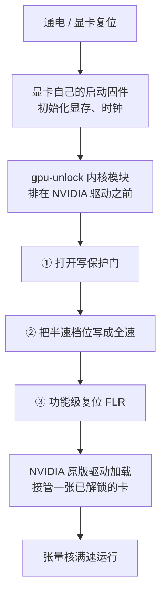

```opener
{
  "word": "½ → 1×",
  "headline": "同一张显卡、同样的功耗，BF16 从 25 涨到 39 TFLOPS。",
  "sub": "我的 RTX 3060 笔记本，装 gpu-unlock 冷启动前后，稠密矩阵乘法实测：",
  "readouts": [
    {"label": "解锁前 BF16", "value": "25 TFLOPS"},
    {"label": "解锁后 BF16", "value": "39 TFLOPS"},
    {"label": "功耗", "value": "都是 ~105 W"}
  ],
  "note": "RTX 3060 Laptop 6GB · 内核 7.0.0-38 · 驱动 595.99.02 · 8192³ 稠密 GEMM · 2026-10-29 本机实测"
}
```

*这篇写给手上有一张消费级 N 卡、用它做本地训练 / 微调 / 出图的人，以及好奇「同一块芯片凭什么分三六九等」的人。不需要你懂显卡微架构，我会先把心智模型搭好再谈细节。性能数字全部来自我自己的一台 RTX 3060 Laptop（6GB），2026-10-29 实测；项目和社区报告的别家数字我会标出来，当参考看。解锁手段依赖的漏洞细节不在这篇展开，想看的我会给原文链接。*

---

## 先说结论（版本与范围）

- **它放开的是什么**：NVIDIA 把消费卡（GeForce）上用 FP32 累加的 **FP16 / BF16 / TF32 张量运算**限制成了半速，和同一块芯片做成的专业卡拉开差距。[gpu-unlock](https://github.com/Zagitta/gpu-unlock) 这个开源内核模块在显卡驱动加载前把限制解开，不改驱动、不刷 VBIOS。
- **本机实测受益**：稠密矩阵乘法 +55% 到 +65%，BF16 小模型训练 +40%。**游戏、普通 FP32 浮点、量化（INT8）模型一点不变**——它们本来就没被锁。
- **范围**：稳定支持 RTX 30（Ampere），RTX 20（Turing）和 40（Ada）是实验性。**RTX 50（Blackwell）解不了**，后面讲为什么。Linux，需要关 Secure Boot 或自签模块。
- **这不是超频**：不碰频率墙、功耗墙、电压，输出逐位不变，所以没有稳定性或画质风险。笔记本有额外代价，见最后一节。

---

## 被锁的是哪一部分：张量核的「发射节奏」

先纠正一个直觉：**被按住的不是张量核本身，而是「多久给它喂一条指令」。**

显卡的计算单元是层层嵌套的。一张卡里有十几个 **SM（流式多处理器）**，每个 SM 里既有跑游戏着色和普通浮点的 **CUDA 核**，也有专做矩阵乘法的 **张量核**，还有一个 **发射单元**——它每个时钟周期最多把一条指令送给执行单元。

NVIDIA 在消费卡上做的手脚，是让发射单元对**特定几类指令**改成**每 2 拍才发一条**。张量核物理上完全能跑满速（同一块芯片装进专业卡就是满速），但它一半时间在空等指令，于是实际吞吐减半。

SM 里有一个配置寄存器，分成几个小字段，每个字段管一类运算的发射速度（有的管普通浮点，有的管 FP16/BF16 矩阵，有的管 TF32 矩阵，有的管整数矩阵）。消费卡出厂时**只有 FP16/BF16 矩阵、TF32 矩阵那几格被设成半速**，其它本来就是全速。记住这一点，下面所有「什么变快、什么不变」都能对上。

> [!NOTE]
> 这解释了一个关键现象：解锁后不是靠拉高频率、也不是多吃电。瓶颈从一开始就是「发射节奏」，不是算力、频率或功耗——下一节的本机数据会把这点坐实。

---

## 本机实测：同功耗，频率反而降了

我在自己的 RTX 3060 Laptop（6GB，GA106M）上，解锁前后各跑一遍稠密矩阵乘法（cuBLAS，FP32 累加，中位数），全程插电、功耗卡在约 105 W。

```chart
{
  "type": "bars",
  "fmt": {"suf": " TFLOPS", "digits": 1},
  "rows": [
    {"label": "BF16 · 解锁前", "value": 25.4, "color": "gray"},
    {"label": "BF16 · 解锁后", "value": 41.9, "color": "seal"},
    {"label": "FP16 · 解锁前", "value": 25.5, "color": "gray"},
    {"label": "FP16 · 解锁后", "value": 41.7, "color": "seal"},
    {"label": "TF32 · 解锁前", "value": 12.6, "color": "gray"},
    {"label": "TF32 · 解锁后", "value": 20.4, "color": "seal"}
  ],
  "legend": [{"color": "seal", "label": "解锁后"}, {"color": "gray", "label": "解锁前"}],
  "caption": "RTX 3060 Laptop 6GB，4096³ 稠密矩阵乘法，解锁前后吞吐（越高越好）。"
}
```

真正能说明问题的是旁边两个数字：**解锁前后功耗都卡在约 105 W，但 SM 频率反而从约 1760 MHz 降到约 1470 MHz，吞吐却翻了快一倍。** 同样的瓦数、更低的频率、接近两倍的活——这正是「发射节奏被放开」的样子：张量核不再空等，不需要更高频率就把活干完了。如果你装完发现频率没降、吞吐也没涨，那就是没解锁成功。

落到真实训练上，我跑了一个 6 层 Transformer 的 BF16 混合精度训练：

```chart
{
  "type": "bars",
  "fmt": {"suf": " token/s", "digits": 0},
  "rows": [
    {"label": "解锁前", "value": 31457, "color": "gray"},
    {"label": "解锁后", "value": 44116, "color": "seal"}
  ],
  "caption": "BF16 混合精度训练一个 6 层 Transformer（d=1024, seq=512, batch=16），每秒处理的 token，+40%。两次最终 loss 一致到小数点后 5 位——速度变了，结果没变。"
}
```

---

## 只有这几类运算变快

同一台机器，我把五类运算放一起看提升幅度，一眼就能看出它的脾气：

```chart
{
  "type": "bars",
  "fmt": {"suf": "%", "digits": 0},
  "rows": [
    {"label": "BF16 矩阵", "value": 65, "color": "seal"},
    {"label": "FP16 矩阵", "value": 64, "color": "seal"},
    {"label": "TF32 矩阵", "value": 63, "color": "seal"},
    {"label": "INT8 矩阵（对照）", "value": 0, "color": "gray"},
    {"label": "FP32 普通浮点（对照）", "value": 0, "color": "gray"}
  ],
  "legend": [{"color": "seal", "label": "被解开了"}, {"color": "gray", "label": "本来就没锁"}],
  "caption": "4096³ 稠密矩阵乘法，解锁前后提升。只有 FP16/BF16/TF32 这三类被锁的运算变快。"
}
```

还有一个干净的旁证：解锁前，我的 INT8 矩阵乘法是 BF16 的 **约 2.9 倍**；解锁后降到 **约 1.9 倍**。满速的 Ampere 芯片，INT8 本该正好是 BF16 的 2 倍——解锁后回到了这个该有的比例，说明 BF16 之前确实被硬生生砍了一半。

对照下面这张「谁受益、谁不受益」，就知道该不该为它折腾：

- **会变快**：PyTorch 的 BF16/FP16 训练与微调、SDXL / Flux 这类扩散模型出图、FlashAttention、大模型的 **prefill（读提示词那段）**。这些都在跑被解开的那几类矩阵运算。
- **不会变快**：游戏帧数（走 FP32 图形管线，没被锁）、大模型**出字速度**（卡在显存带宽，不是算力）、llama.cpp 跑的量化 GGUF（走 INT8/INT4，没被锁）、普通 FP32 计算。

> [!TIP]
> 想提游戏帧数的，这个项目帮不上忙——它和超频是两回事。它是给**本地 AI 的半精度计算**松绑的。

项目 README 还列了 RTX 3060 到 4090 一长串各卡的提升幅度（+65% 到翻倍不等），以及 vLLM prefill、LoRA 微调的收益。那些是作者和社区报告的数字，**当参考看**；这篇里带「本机实测」的才是我自己量的。

---

## 它怎么在开机时把锁打开

前面说过，那个速度档位被一道**写保护门**挡着：系统正常跑起来后，从驱动这侧写它写不进去。所以必须趁显卡还没被普通驱动接管、它自己的启动固件还在跑的那个窗口动手。

gpu-unlock 是一个 Linux 内核模块，排在 **NVIDIA 驱动之前**加载，在开机那个窗口里做三件事，然后把卡交还给原版驱动：



它靠的是显卡启动固件里一个**已知漏洞**（和早前解锁 NVIDIA 矿卡 CMP 用的是同一个）把门打开。因为动作发生在驱动之前，所以**不用改驱动、不刷 VBIOS，驱动更新了也不用重做**。具体的漏洞怎么构造，这篇不展开——想深入的看作者原文 [《How Ampere was unlocked》](https://github.com/Zagitta/gpu-unlock/blob/main/docs/How%20Ampere%20was%20unlocked.md)。

这也带出一个硬约束：**必须冷启动**。只要原版驱动已经碰过这张卡，窗口就关了，模块会拒绝并提示先断电。笔记本尤其要注意——独显空闲时会断电，一断电解锁就被复位，这是下面要讲的坑。

---

## 为什么 RTX 50 解不了

先纠正一个容易误会的点：**不是 NVIDIA 在新卡上取消了这个限制**——实测 Blackwell（RTX 50）上那个半速档位依然在，大约还是 51% 的速率。是**解锁的方法进不去了**。

这套方法本来依赖一条很特定的链：显卡安全处理器上那段签名启动固件里的缺陷，而这个缺陷之所以能被研究出来，是因为 NVIDIA 当年漏发过一份用公开测试密钥加密的调试固件。Turing / Ampere / Ada（20/30/40 三代）**共用**这条启动链，所以一套方法通吃三代。

Blackwell 把这条链整个换掉了：启动信任根换成了另一套安全处理器，原来那段固件被踢出了开机流程——利用点所在的代码在新卡上根本不跑了，也没有泄露的新固件可供反推。作者在 FAQ 里直接写了 Blackwell「不支持，且不太可能」。

> [!NOTE]
> 一句话：老卡能解，是赶上了「三代共用一条启动链 + 一份漏发的调试固件」这两个历史条件；新卡换了更干净的安全启动架构，把这条路提前焊死了。**锁还在，钥匙没了。**

---

## 这类「绕过人为限制」不是头一回

NVIDIA 用固件 / 驱动给同一代硅做分级、社区想办法绕过，这事已经来回拉锯了很多年。gpu-unlock 只是最新一例：

| 锁的是什么 | 当年怎么绕 |
| --- | --- |
| GeForce ↔ Quadro 的专业功能 | 软改设备 ID，让驱动把游戏卡认成专业卡（更早还有 Radeon→FireGL） |
| 消费卡的 vGPU 虚拟化 | `vgpu_unlock`，把被留给专业卡的虚拟化功能放开 |
| **LHR 挖矿限速**（最像这次，直接锁算力） | 第三方矿工软件绕过约 70%，后来被完全解开；NVIDIA 甚至自己手滑用一版驱动全放开过一次，最后又在另一版驱动里把限速**自己悄悄删了** |
| 矿卡 CMP（锁显存和显示输出） | `cmpunlocker`，**这次 gpu-unlock 复用的就是它那套漏洞** |

共同点:这些从来不是「把小卡变大卡」,而是**同一块 / 同一代硅本来就有的能力被人为按住,社区再把它按回去**。规律也很清楚:厂商往往修一个、被发现下一个,或者像 LHR 那样最后干脆放弃——但也会像 Blackwell 这样,在新架构上把路提前堵死。

---

## 要不要装：代价和回退

它不碰频率墙、功耗墙和电压，输出逐位不变，所以**没有超频那种稳定性或画质风险**；失败时原版驱动照常加载，最坏只是没解锁。但有几个实打实的代价，尤其笔记本：

- **必须关 Secure Boot**，或者给内核模块自签名，否则模块加载不了。
- **笔记本要让独显一直通电**（`NVreg_DynamicPowerManagement=0x00`），否则独显空闲断电后解锁被复位。代价是**电池续航变差、更热**。我这台还需要 `NVreg_GpuInitOnProbe=1`，不然驱动初始化时机会把解锁盖掉（见项目 issue #135）。
- **显存不会变多**。6GB 还是 6GB，能跑多大的模型没变，只是同样的活更快。
- **当前主分支漏了一些笔记本型号**。我这张 RTX 3060 Laptop（`10de:2520`）的 ID 在一次重构里被漏掉了，装之前得自己把型号补回去（上游 PR #212 做的就是这件事）。
- **回退很简单**：开机时在 GRUB 菜单按 `e` 删掉那行内核参数，就是一次性不解锁；要彻底关掉，删掉内核参数和那个 modprobe 配置、卸载两个包、重建 initramfs 即可。

什么时候值得装：你**经常用这张消费级 N 卡做 BF16/FP16 的训练、微调或扩散模型出图**，且能接受上面的代价。什么时候别碰：你主要是**打游戏**，或者只用 llama.cpp 跑量化模型出字——那两种它都帮不上忙。

---

## 怎么自己量

别信任何单一数字（包括我的），自己跑一遍最可靠。要点：

- **测被锁的那几类**：FP16/BF16/TF32 的稠密矩阵乘法，用 FP32 累加（PyTorch 里把 `allow_fp16/bf16_reduced_precision_reduction` 关掉），再带上 FP32 和 INT8 作对照——对照项不变才说明你测的是解锁本身，不是别的波动。
- **同时记录 SM 频率和功耗**：解锁的特征是「同功耗、频率不升甚至降、吞吐涨」。只看吞吐涨可能是别的原因（比如顺手升了频率）。
- **笔记本插着电、先静置几分钟再测**，热节流会把数字搅乱。
- 解锁后 `journalctl -k -b | grep gpu_unlock` 要能看到 `unlocked`。

我用的测速脚本（PyTorch，约 4 分钟，不花钱）放在文末附录。

---

**一句话收尾**：gpu-unlock 不是超频、不提帧、不让你的卡变成另一张卡。它只是把 NVIDIA 为了卖高价专业卡、在消费卡上人为按下的那半速张量核**按回原位**——仅此而已，但对用消费卡做本地 AI 的人，这「仅此而已」是实打实的近两倍。

<details>
<summary>附录：本机测速脚本与完整数据</summary>

测速脚本见我的调研仓库 `bench_tensor.py`（PyTorch，GEMM 4096/8192 + BF16 训练，自动记录频率 / 功耗）。本机完整数据（RTX 3060 Laptop 6GB，内核 7.0.0-38，驱动 595.99.02，2026-10-29，插电 ~105 W）：

| 项（4096³ / 8192³） | 解锁前 | 解锁后 |
| --- | --- | --- |
| FP16 | 25.5 / 24.9 TFLOPS | 41.7 / 38.6 |
| BF16 | 25.4 / 25.2 | 41.9 / 39.4 |
| TF32 | 12.6 / 12.2 | 20.4 / 20.5 |
| FP32（对照） | 6.5 / 7.9 | 6.5 / 8.0 |
| INT8（对照） | 74.5 / 74.5 TOPS | 74.5 / 75.8 |
| BF16 训练 | 31,457 token/s | 44,116 token/s |

频率示例：BF16 4096³ 从约 1760 MHz 降到约 1470 MHz，功耗两边都约 105 W。

</details>
