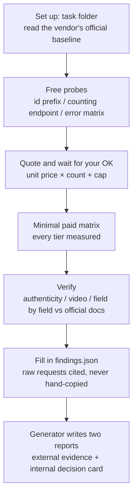

**llm-relay-audit** is the audit procedure I use at work when choosing upstream suppliers for a platform, stripped of everything internal and open-sourced as an Agent skill. Give a relay's base URL and key to an Agent such as Claude Code, Codex or Cursor; it compares the relay with the official API item by item following a fixed procedure, and hands you two reports: one you can send straight to the vendor, one for whoever makes the call.

[🐙 GitHub](https://github.com/YouToco/llm-relay-audit)

[📖 Guide: check a relay API before you buy](/en/posts/verify-llm-relay-api/)

[📦 v0.3.0 release notes](https://github.com/YouToco/llm-relay-audit/releases/tag/v0.3.0) · [📄 Sample report PDFs](https://github.com/YouToco/llm-relay-audit/tree/main/docs/samples)

```bash
# one-line install (Claude Code, Codex, Cursor, Gemini CLI)
npx skills add YouToco/llm-relay-audit
```

## What it solves

Cheap Claude, GPT and Seedance relays keep multiplying, with groups labelled "official" or "official key", but a group name is not evidence. Among the 30-odd relays I tested, it caught things like these:

- a subscription-pool relay adding 508 tokens of Claude Code's system prompt to every request, billed at your price;
- responses naming the expensive model you paid for while the error revealed a different one, priced as the expensive one;
- a valid "run inference only in the US" parameter stripped silently, with the response still showing global inference.

All of it can be found before you pay; it just has to be done item by item for every relay and turned into a report someone else can read, which is exactly the kind of work to hand to an Agent.

## How it works



Seventeen numbered rules constrain every step the Agent takes, for example: **quote before spending** (every tier measured, never extrapolated); **"identical" must be computed** (fields, response headers and streaming event names diffed by a program, not by eye); **every raw request goes to JSONL**; **stop on other people's data** (if a probe exposes another tenant's data, record only that it is reachable, and read nothing).

It ships official baselines for 10 vendors, plus notes on two kinds of relay programs:

| Line | Official baselines |
|---|---|
| Text | Claude (incl. Bedrock), OpenAI (incl. Azure), Grok, Gemini, Kimi, GLM, DeepSeek |
| Video | Alibaba wan3, MiniMax H3, Seedance (Volcengine Ark / BytePlus) |
| Relay programs | new-api / one-api (groups, ratios, logs, passthrough), sub2api (subscription pools) |

## The output

The external evidence report covers only "this relay vs the official API": claims vs measurements, authenticity evidence, differences ranked by customer impact, what the vendor should fix, and an appendix with official and relay raw requests side by side. Its first page:

.")

The internal decision card is one A4 page: the verdict (primary / backup / fix first / reject), cost and 30-day success rate against your existing lines for the same model, and what your gateway would need to change:

.")

Write `"lang": "en"` for an English report; individuals who only want to know whether a relay is genuine can add `--external-only` to get the external report alone.

## Engineering worth mentioning

- **Money and keys**: the probe library masks keys everywhere it writes (environment, headers, URLs, echoed bodies, raw streams); a paid request that may already have reached the server is never resent, so you never buy one video three times; keys are never sent to a different domain.
- **Video authenticity is more than "signature valid"**: anyone can self-sign a certificate carrying a vendor's name, and the signature will still validate. The C2PA check compares the signing certificate's fingerprint and calls a file official only if it matches an original fetched from the official API.
- **No leaks in the external report**: the generator refuses to write it if an internal line name, another vendor or anything key-like appears, whether hidden by letter case, escaping, markdown, image captions or file names.
- **Verifiable**: 84 unit tests; CI runs the tests, example validation, Agent Skills spec validation (`skills-ref`), npx discoverability and a secret scan; every GitHub Action is pinned to a commit SHA.
- **Reviewed three ways before release**: before v0.3.0, three independent Agents looked for problems as a new user, a content reviewer and a code auditor; security, billing and content issues were fixed before publishing (details in the [CHANGELOG](https://github.com/YouToco/llm-relay-audit/blob/main/CHANGELOG.md)).

## Tech stack

**Skill** · Agent Skills spec (SKILL.md + references + scripts + assets), works with Claude Code, Codex, Cursor and Gemini CLI; also installable from the Claude Code plugin marketplace

**Scripts** · Python 3.10+ (the report generator and probe library use only the standard library) · headless Chrome for PDFs · c2pa-python · ffmpeg / ffprobe

**Engineering** · unittest · GitHub Actions · detect-secrets · MIT license

## My role

**Solo**: the audit method (from integration tests of 30-odd relays at work) · rules and procedure design · report generator · sanitizing for open source · testing and release.

---

*Open source; code on [GitHub](https://github.com/YouToco/llm-relay-audit).*
