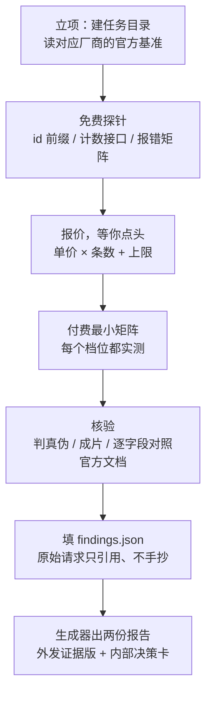
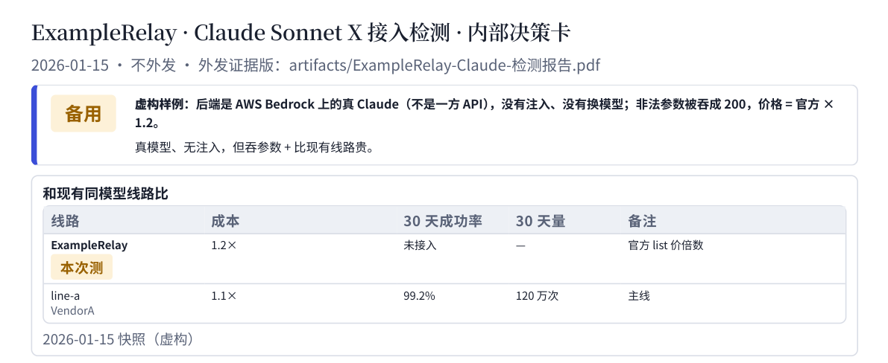

**llm-relay-audit** 是我在工作里给平台挑上游时用的检测规范，脱敏后开源成的 Agent skill。把一家中转的地址和 key 交给 Claude Code、Codex、Cursor 这类 Agent，它按固定流程把这家和官方 API 逐项对比，最后交给你两份报告：一份可以直接发给供应商，一份给拍板的人。

[🐙 GitHub 源码](https://github.com/YouToco/llm-relay-audit)

[📖 使用指南：买中转 API 之前先验货](/posts/verify-llm-relay-api/)

[📦 v0.3.0 发布说明](https://github.com/YouToco/llm-relay-audit/releases/tag/v0.3.0) · [📄 报告样例 PDF](https://github.com/YouToco/llm-relay-audit/tree/main/docs/samples)

```bash
# 一行安装（Claude Code、Codex、Cursor、Gemini CLI 都能用）
npx skills add YouToco/llm-relay-audit
```

## 它解决什么

便宜的 Claude、GPT、Seedance 中转越来越多，分组名写着「官转」「官 key」，但分组名不是证据。我测过的 30 多家里，抓到过这些：

- 订阅号池型中转给每个请求塞 508 个 token 的 Claude Code 系统提示，按你的价照收；
- 回包写着你买的贵模型，报错里露出来的却是另一个型号，价格按贵的收；
- 合法的「只在美国境内推理」参数被静默剥掉，回包照样显示全球推理。

这些都能在付款前查出来，只是要每家都一项不漏地做一遍，再整理成别人看得懂的报告，这正适合交给 Agent。

## 怎么工作



17 条编号规则约束 Agent 的每一步，例如：**先报价后花钱**（每个档位都实测，不线性外推）；**「一致」要程序比**（字段、响应头、流式事件名两边求差集，不靠肉眼）；**原始请求全部落 jsonl**；**越权即停**（探针露出别人的数据，只记「能看到」，不读内容）。

内置 10 家厂商的官方基准，另有两类中转程序的行为笔记：

| 线路 | 官方基准 |
|---|---|
| 文本 | Claude（含 Bedrock）、OpenAI（含 Azure）、Grok、Gemini、Kimi、GLM、DeepSeek |
| 视频 | 阿里 wan3、MiniMax H3、Seedance（火山方舟 / BytePlus） |
| 中转程序 | new-api / one-api（分组、倍率、日志、参数透传）、sub2api（订阅号池） |

## 成品

外发证据版只写「这家 vs 官方」两方：声称与实测、真伪证据、差异按是否影响客户分级、要对方修的事，附录是官方和中转的原始请求响应并排。第一页长这样：


内部决策卡一页 A4：判定（主线 / 备用 / 先修后接 / 不接）、和现有同模型线路的成本与 30 天成功率对比、接入网关要改什么：



写一行 `"lang": "en"` 就出英文报告；只想知道「是不是真货」的个人用户加 `--external-only`，只出外发版。

## 工程上值得说的

- **钱和 key 的安全**：探针库在所有落盘位置给 key 打码（环境变量、请求头、URL、回显的正文、流式原文都算）；可能已经送达的付费请求绝不自动重发，避免一张视频买三遍；key 不会被带到别的域名。
- **视频真伪不只看「签名有效」**：任何人都能自签一张写着厂商名字的证书，签名照样有效。C2PA 检查会比对签名证书的指纹，和从官方 API 拿到的原片对上才算官方原片。
- **外发报告防泄密**：外发版里出现内部线路名、别家供应商名或像 key 的字符串，生成器直接拒绝输出；大小写、转义、markdown 标记、图片说明、文件名都绕不过去。
- **可验证**：84 个单元测试；CI 跑测试、样例校验、Agent Skills 规范校验（`skills-ref`）、npx 可发现性和密钥扫描；GitHub Actions 全部钉到 commit SHA。
- **三路复查后再发版**：v0.3.0 前让三个独立 Agent 分别以新用户、内容审校、代码审计的角度挑错，安全、计费、内容三类问题修完再发布（明细见 [CHANGELOG](https://github.com/YouToco/llm-relay-audit/blob/main/CHANGELOG.md)）。

## 技术栈

**Skill** · Agent Skills 规范（SKILL.md + references + scripts + assets），兼容 Claude Code、Codex、Cursor、Gemini CLI；Claude Code 插件市场同时可装

**脚本** · Python 3.10+（报告生成器和探针库只用标准库）· Chrome 无头打印 PDF · c2pa-python · ffmpeg / ffprobe

**工程** · unittest · GitHub Actions · detect-secrets · MIT 协议

## 我的角色

**独立完成**：检测方法（来自实际工作中 30 多家中转的接入测试）· 规则与流程设计 · 报告生成器 · 脱敏开源 · 测试与发布。

---

*开源项目，源码见 [GitHub](https://github.com/YouToco/llm-relay-audit)。*
